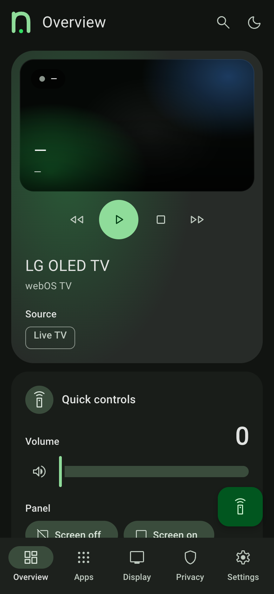
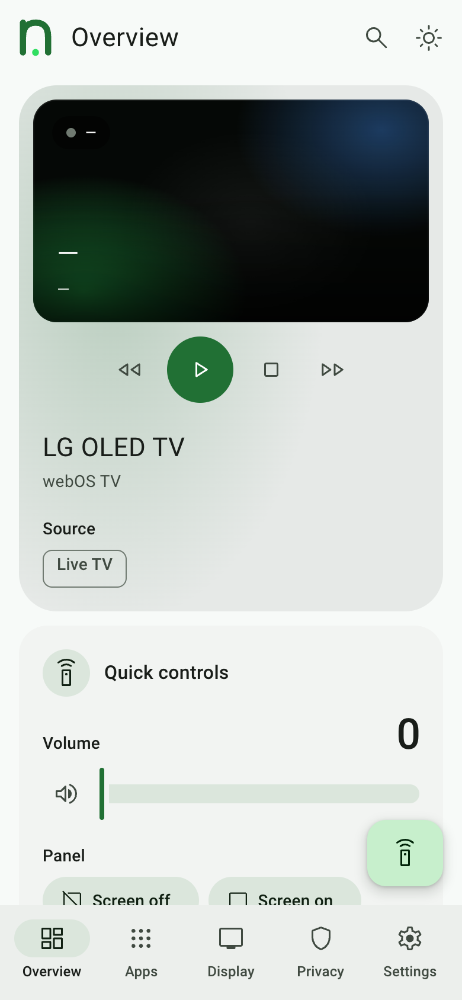
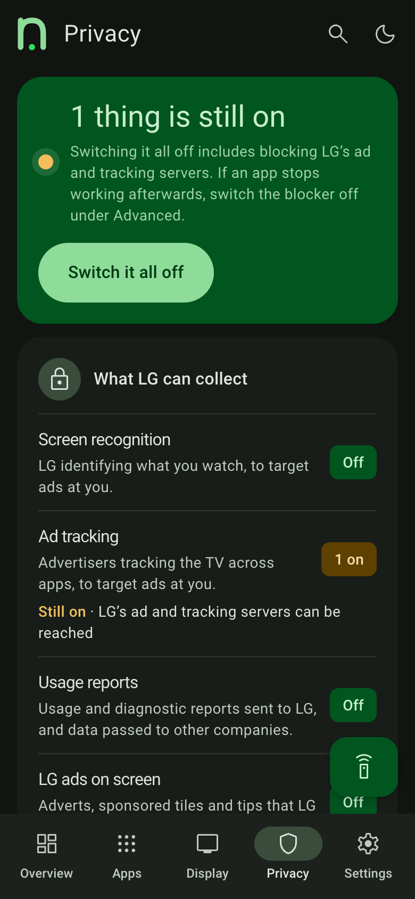
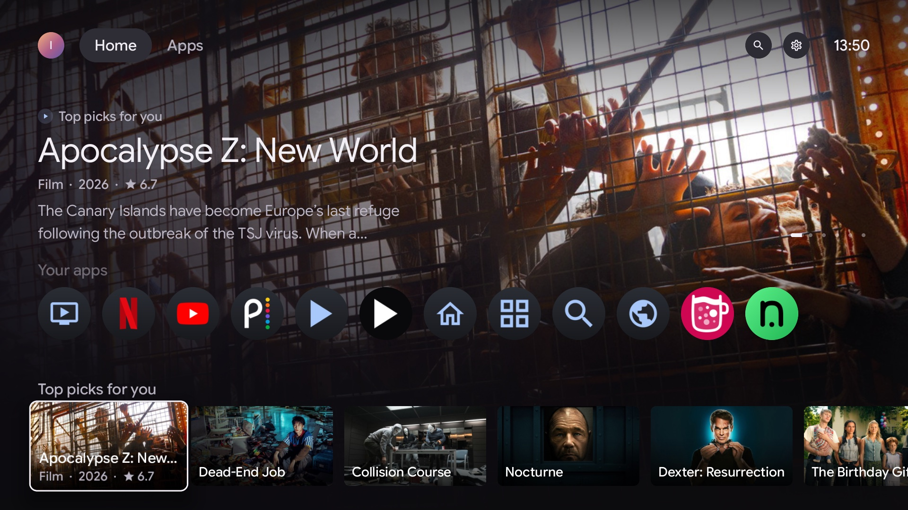
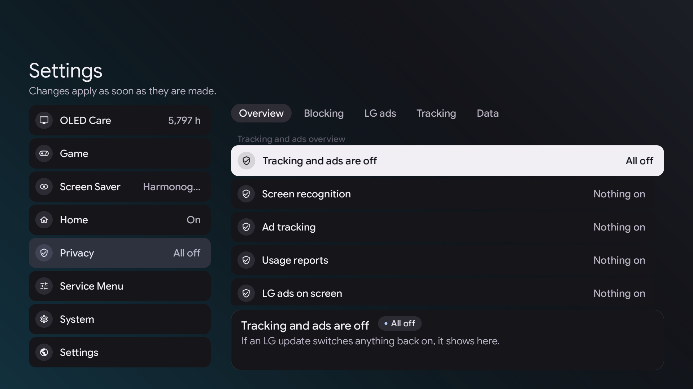
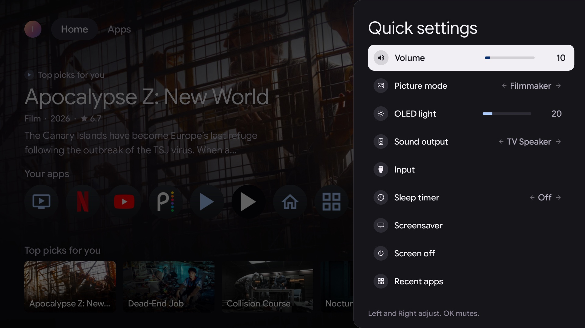

<p align="center"></p>

<h1 align="center">Native Tv</h1>

<p align="center"><b>Your TV, your rules.</b><br>An open-source dashboard, privacy toolkit and Home Assistant bridge for rooted LG webOS TVs.</p>

<p align="center">
  <a href="LICENSE"></a>
  <a href="https://github.com/ihtisham1211/native-tv/actions/workflows/checks.yml"></a>
  <a href="https://ihtisham1211.github.io/native-tv/"></a>
  
  
</p>

<p align="center">
  <a href="https://ihtisham1211.github.io/native-tv/">Documentation</a> ·
  <a href="https://ihtisham1211.github.io/native-tv/getting-started/install/">Install</a> ·
  <a href="https://ihtisham1211.github.io/native-tv/getting-started/tested-tvs/">Tested TVs</a> ·
  <a href="https://ihtisham1211.github.io/native-tv/integrations/home-assistant/">Home Assistant</a> ·
  <a href="https://github.com/ihtisham1211/native-tv/issues">Issues</a>
</p>

**Native Tv** is a server that runs directly on a rooted LG webOS TV. It gives the TV a live browser dashboard for any phone or computer, a native app on the TV itself, and an MQTT bridge for Home Assistant and other smart-home software.

Use it to control an LG OLED or LCD TV without the cloud, see and switch off what LG's ACR (Live Plus), ad tracking and data agreements collect, block LG's ad and telemetry servers, debloat apps and background services, remap the remote's buttons, protect an OLED panel from burn-in, and read the TV's hardware telemetry.

<p align="center">
  
  
</p>

> [!NOTE]
>
> ## The TV belongs to its owner.
>
> Native Tv is for owners who do not want a network-connected appliance used as
> a platform for advertising, telemetry and vendor-controlled experiences. It
> brings control, visibility and automation back to the device: ways to remove
> ads, withdraw from agreements and services that monetise the owner's data,
> and a simpler TV, with customisation and local smart-home integration.
>
> Native Tv itself is local and transparent, and needs no cloud service. It
> collects no data, shows no ads and has no dark patterns.

## Features

* **[Control without the cloud](https://ihtisham1211.github.io/native-tv/dashboard/control/).** D-pad, volume, playback keys, app launcher, picture presets, sound output routing, power and reboot, from any browser.
* **[Privacy: see what the TV collects, and switch it off](https://ihtisham1211.github.io/native-tv/dashboard/privacy/).** Whether LG's content-recognition engine is running, the advertising identifier, and every recorded data agreement, most of them switchable. An on-TV blocker for LG's ad and telemetry endpoints, and a switch for the two diagnostics services that upload to LG. [What LG's ACR does](https://ihtisham1211.github.io/native-tv/administration/acr/).
* **[Debloat and home screen cleanup](https://ihtisham1211.github.io/native-tv/dashboard/apps/).** Install apps from the Homebrew Channel catalogue, uninstall LG apps to reclaim flash storage, disable background services to free RAM and CPU ([the list](https://ihtisham1211.github.io/native-tv/dashboard/apps/#turn-off-lgs-bloatware-background-services): LG's ad service, Live Plus, the diagnostics and telemetry uploaders, the ThinQ cloud services and more), hide built-in apps from the launcher, and on webOS 9 strip LG's Home screen down to apps and inputs.
* **[Admin PIN](https://ihtisham1211.github.io/native-tv/administration/security/).** A four-digit PIN, asked in the TV's first-run setup, guards installing and removing apps, SSH keys, restoring a backup and power actions, on the TV and in the dashboard.
* **[Switch off when idle](https://ihtisham1211.github.io/native-tv/dashboard/advanced/#switch-off-when-idle).** The TV switches itself off after 15 minutes to eight hours with no key press, no change and nothing playing, with a toast a minute before. An HDMI input is never switched off.
* **[Power and standby](https://ihtisham1211.github.io/native-tv/dashboard/advanced/#power-and-standby).** Keep the TV on the network while it is off, Quick Boot, Wake-on-LAN, Always Ready and the On and Off timers, and a switch that [blocks LG's firmware updates](https://ihtisham1211.github.io/native-tv/dashboard/advanced/#system-updates), which can take root access away.
* **[Remote button remapping](https://ihtisham1211.github.io/native-tv/dashboard/apps/#remote-keys).** Point Netflix, Prime Video, Guide, the colour keys and other shortcut buttons at any app, an HDMI input or Live TV. The change survives reboots.
* **[OLED care](https://ihtisham1211.github.io/native-tv/dashboard/oled-care/).** Panel hours, compensation cycle progress, Pixel Refresher scheduling and failure alerts, and switches for screen shift, logo dimming, ASBL and Global Stress Reduction, which are normally reachable only from the service menu.
* **[Game mode](https://ihtisham1211.github.io/native-tv/dashboard/game/).** On TVs with LG's Game Optimizer, a game's frame rate in large type while the source uses VRR, beside the Optimizer's settings.
* **[Home Assistant and MQTT](https://ihtisham1211.github.io/native-tv/integrations/home-assistant/).** The TV appears as one device through MQTT Discovery, with controls, telemetry and [remote button events](https://ihtisham1211.github.io/native-tv/integrations/home-assistant-remote-buttons/) for automations. The same topics work for any MQTT client.
* **[Monitoring](https://ihtisham1211.github.io/native-tv/dashboard/metrics/).** SoC temperature, per-core CPU load, memory, swap, Wi-Fi signal and throughput; [Prometheus metrics](https://ihtisham1211.github.io/native-tv/integrations/prometheus/) and [syslog forwarding](https://ihtisham1211.github.io/native-tv/integrations/syslog/).
* **[Update notice](https://ihtisham1211.github.io/native-tv/dashboard/server/).** The Server tab says when a newer release is out, when asked or once a day if switched on, with its release notes, package and SHA-256, and opens the Homebrew Channel on the TV to install it. Off until asked, so the TV contacts GitHub only on request.
* **[Backup and logs](https://ihtisham1211.github.io/native-tv/dashboard/server/).** LG's sound, device, HDMI and ad settings and Native Tv's own, saved to a file or once a day on the TV and restored on the same TV or another. The [System, Native Tv and kernel logs](https://ihtisham1211.github.io/native-tv/dashboard/tools/) in one searchable timeline in the browser, with no SSH, and private details hidden when copied or exported.
* **[Screen savers](https://ihtisham1211.github.io/native-tv/dashboard/screen-savers/) and [the service menu](https://ihtisham1211.github.io/native-tv/dashboard/service-menu/).** A clock, starfield, fireworks or the TV's own readings in place of LG's screen saver; LG's engineering menu opened from a browser, with no service remote, and unlocked where newer firmware cuts it down.
* **[A native TV app](https://ihtisham1211.github.io/native-tv/apps/tv-app/).** A C++ and OpenGL ES client after Google TV's design puts the same readings and controls on the TV, driven by the remote, and offers [Native Tv Home](https://ihtisham1211.github.io/native-tv/dashboard/home/) as a replacement home screen. It is drawn on the GPU at the display's 60 frames a second with no browser behind it ([how smooth it is](https://ihtisham1211.github.io/native-tv/apps/tv-app/#how-smooth-it-is)).

## Screenshots

<p align="center">
  
  
  
</p>
<p align="center">
  
  
  
</p>
<p align="center"><sub>The dashboard shots come from the repository's TV emulator, so the readings are stand-in values. The TV app shots are captured on a real TV.</sub></p>

## Compatibility

| | |
| :-- | :-- |
| **webOS** | 4 and later. webOS 2.2 and 3.x ran the earlier Node release and are not supported by the native server |
| **Verified with this server** | LG B3 (OLED65B3PUA), webOS 10.3.2. Other models and versions are untried |
| **Reports from the earlier release** | 48 TVs across 33 series, 2015 to 2026 models, webOS 2.2 to 11 ([the table](https://ihtisham1211.github.io/native-tv/getting-started/tested-tvs/)) |
| **Panels** | OLED (panel wear telemetry and burn-in controls) and LCD (the OLED Care tab hides itself) |
| **Access** | Rooted, with the Homebrew Channel; SSH or telnet |

LG names its versions two ways; [webOS version numbers](https://ihtisham1211.github.io/native-tv/getting-started/tested-tvs/#webos-version-numbers) gives both.

## Install

Native Tv installs from a computer on the same network as the TV, over SSH, or over the Homebrew Channel's telnet when no SSH key is set up. The TV needs no internet access.

The computer needs Git, Bash, Python 3, CMake, `pkg-config` and a [webOSbrew native SDK](https://github.com/webosbrew/native-toolchain), which is built for macOS (Apple silicon and Intel) and arm64 Linux only.

1. Root the TV and install the [Homebrew Channel](https://github.com/webosbrew/webos-homebrew-channel). Native Tv does not root the TV.
2. Clone this repository on the computer: `git clone https://github.com/ihtisham1211/native-tv.git && cd native-tv`.
3. Build the ARM server and TV app with the SDK: `python3 native-tv/build.py --sdk /path/to/arm-webos-linux-gnueabi_sdk-buildroot`.
4. Run `native-tv/lifecycle/deploy.sh <tv-ip>` from the repository root.
5. Open `http://<tv-ip>:8080/` in a browser.

The [installation guide](https://ihtisham1211.github.io/native-tv/getting-started/install/) has the details and troubleshooting.

### Try the dashboard without a TV

The emulator serves the dashboard at `http://localhost:8080/` with stand-in readings. It needs Node.js on the computer; the TV runs none.

```bash
python3 native-tv/build.py --service-only
node scripts/emulate-tv.js --open
```

## Install with an AI assistant

An AI coding assistant with a shell on a computer on the TV's network (Claude Code, Codex and the like) can run the install above. Give it the TV's address and this prompt:

> Install Native Tv on my rooted LG TV at `<tv-ip>`. Follow the "Install with an AI assistant" section of the README at https://github.com/ihtisham1211/native-tv, and ask me before doing anything it does not list.

**Instructions for the assistant.** Ask the owner first: the TV's IP address (Settings → Network on the TV); whether the TV is already rooted with the Homebrew Channel (if not, stop: rooting is not part of this install); and whether a 150 MB SDK download is fine. The deploy logs in as `root` with the computer's SSH key, and otherwise falls back to the Homebrew Channel's telnet, which has to be switched on in that app's settings. It never prompts for a password, so do not ask for one. A key outside the default location goes in `~/.config/nativetv/deploy.env` as `NATIVETV_SSH_KEY=<path>`.

1. Check the computer. `uname -sm` must say `Darwin arm64`, `Darwin x86_64` or `Linux aarch64`, because the SDK has no other build; on any other computer, stop and tell the owner. Install what is missing with the owner's OK.

   ```bash
   uname -sm
   for t in git python3 cmake pkg-config bash ssh curl; do command -v "$t" >/dev/null || echo "missing: $t"; done
   ```

2. Clone the repository: `git clone https://github.com/ihtisham1211/native-tv.git && cd native-tv`.
3. Get the SDK the project's CI builds with, unless the owner already has a relocated one:

   ```bash
   platform=$(uname -s | tr '[:upper:]' '[:lower:]')-$(uname -m)
   mkdir -p ~/webos-sdk
   curl -fsSL "https://github.com/webosbrew/native-toolchain/releases/download/webos-d7ed7ee.6/arm-webos-linux-gnueabi_sdk-buildroot_$platform.tar.bz2" | tar -xj -C ~/webos-sdk
   ~/webos-sdk/arm-webos-linux-gnueabi_sdk-buildroot/relocate-sdk.sh
   ```

4. Build the ARM server and TV app. Leave out `--service-only`: it skips the TV app, which the deploy packages too.

   ```bash
   python3 native-tv/build.py --sdk ~/webos-sdk/arm-webos-linux-gnueabi_sdk-buildroot
   ```

5. Deploy from the repository root. A first install also adds the Native Tv tile to the TV's home screen; `--no-app` leaves the home screen alone. The install worked when the output ends with `done - open http://<tv-ip>:8080/`. On `Nothing was installed`, run it once more and check the TV is on.

   ```bash
   native-tv/lifecycle/deploy.sh <tv-ip>
   ```

6. When SSH works, `ssh root@<tv-ip> /var/lib/tvweb/tvwebctl status` shows whether the server is running, and `/var/lib/tvweb/tvweb.log` on the TV says why it is not.
7. Give the owner the dashboard address. The Admin PIN, who can reach the dashboard and Home Assistant are the owner's to choose, in the TV app's Settings or the dashboard. Say that the dashboard has no login by default ([Security](#security)), and that the two optional [API keys](#api-keys) are theirs to get: do not create accounts for them.

Rules for the assistant:

* Do only what is listed here. Do not reboot the TV, change its settings or switch on anything labelled experimental unless the owner asks.
* Never print or commit the access token, the MQTT password or an API key in `/var/lib/tvweb/config.json` on the TV.
* Never forward port 8080 to the internet.
* If a step fails twice, stop and show the owner the output. Do not edit `deploy.sh` or try another install route.
* To undo the install, follow [updating and uninstalling](https://ihtisham1211.github.io/native-tv/getting-started/managing/) exactly.

## API keys

Installing and running Native Tv needs no account or key: the dashboard, the TV app, the privacy tools and the Home Assistant bridge all work without one. (The MQTT bridge needs the broker's address and, if it has one, a username and password.) Two optional keys switch on rows of titles in [Native Tv Home](https://ihtisham1211.github.io/native-tv/dashboard/home/), which is experimental:

| Key | What it adds | Where it goes |
| :-- | :-- | :-- |
| TMDB API key | The film and series rows: titles, posters, details and trailers. Without it Home shows only what is on the TV | The browser dashboard: Apps, **Native Tv Home** tab, **Films and series** (or `"tmdbKey"` in `config.json`) |
| YouTube Data API key | The **Trending on YouTube** row | The same tab, **Trending on YouTube** (or `"youtubeKey"` in `config.json`) |

The TV app has no field for either key. The Native Tv Home tab (`http://<tv-ip>:8080/?tab=home`) appears only on TVs where Native Tv Home is offered: webOS 9 and 10, and webOS 11 once `"allowExperimentalHome": true` is set.

**Get a TMDB key** (free):

1. Create an account at [themoviedb.org](https://www.themoviedb.org/) and confirm the email address.
2. Open [Settings, API](https://www.themoviedb.org/settings/api), request an API key and answer the short form about how it will be used.
3. Copy the **API Key**, which is 32 letters and digits. Do not copy the long **API Read Access Token**: Native Tv refuses it.
4. Paste the key into **Films and series** on the dashboard's Native Tv Home tab and save it. It stays on the TV and is never shown again; **Remove** deletes it.

**Get a YouTube Data API key** (free):

1. In the [Google Cloud console](https://console.cloud.google.com/), create a project or pick one.
2. Under APIs & Services, Library, enable **YouTube Data API v3**.
3. Under APIs & Services, Credentials, choose Create credentials, then API key. Restricting the key to the YouTube Data API v3 is optional.
4. Paste the key into **Trending on YouTube** on the dashboard's Native Tv Home tab, below **Films and series**, and save it. Or add `"youtubeKey": "<the key>"` to `/var/lib/tvweb/config.json` on the TV, or to `native-tv/lifecycle/config.json` before the first deploy: the server reads the file again when it changes, so no restart is needed.

This product uses the TMDB API but is not endorsed or certified by TMDB. [Native Tv Home](https://ihtisham1211.github.io/native-tv/dashboard/home/) has the details of what is fetched and when.

## Security

The dashboard has **no authentication by default**, for frictionless control from any phone or browser on a trusted local network. **Never expose port 8080 directly to the internet (do not port-forward).** [Security](https://ihtisham1211.github.io/native-tv/administration/security/) covers the token, closing the port to the network, and MQTT. Vulnerabilities are reported as set out in [SECURITY.md](SECURITY.md).

## FAQ

**How is ACR (Live Plus) turned off on an LG TV?**
The Privacy tab shows whether LG's content-recognition engine is running and switches it off, with the advertising identifier, ad tracking and the data agreements recorded on the TV. [What LG's ACR does](https://ihtisham1211.github.io/native-tv/administration/acr/) sets out what it samples and which controls act on it.

**Does Native Tv root the TV?**
No. The TV has to be rooted first, and Native Tv installs through the [Homebrew Channel](https://github.com/webosbrew/webos-homebrew-channel)'s SSH or telnet access.

**Does it need a cloud account or internet access on the TV?**
No. It runs on the TV, serves the dashboard on the local network, collects no data and shows no ads.

**How does it connect an LG TV to Home Assistant?**
Through an MQTT broker. The TV publishes itself with MQTT Discovery as one device with its controls and telemetry, and the remote's buttons can fire automations. [Setup](https://ihtisham1211.github.io/native-tv/integrations/home-assistant/) and the [entity list](https://ihtisham1211.github.io/native-tv/integrations/home-assistant-entities/) are in the docs.

**Does it work on LCD and non-OLED LG TVs?**
Yes. The dashboard, controls and telemetry work on LCD panels; the OLED Care tab hides itself.

**Is the TV app smooth, or does it lag like a slow home screen?**
It is a native OpenGL ES client, not a web page, and it draws at the display's 60 Hz. On an LG B3 with the processor busy (load average about 32) its frames arrive 15 to 18 ms apart, against 16.7 ms ideal. [How it stays smooth](https://ihtisham1211.github.io/native-tv/apps/tv-app/#how-smooth-it-is) lists the reasons and the measurement.

**What does it change on the TV?**
[What it changes on the TV](https://ihtisham1211.github.io/native-tv/administration/tv-changes/) lists every change and how each is undone. The read-only system partition is left untouched.

## Documentation

* [Installing](https://ihtisham1211.github.io/native-tv/getting-started/install/), [tested TVs](https://ihtisham1211.github.io/native-tv/getting-started/tested-tvs/) and [updating and uninstalling](https://ihtisham1211.github.io/native-tv/getting-started/managing/)
* [The dashboard](https://ihtisham1211.github.io/native-tv/dashboard/), tab by tab, and [the TV app](https://ihtisham1211.github.io/native-tv/apps/tv-app/)
* [Home Assistant](https://ihtisham1211.github.io/native-tv/integrations/home-assistant/), [Prometheus](https://ihtisham1211.github.io/native-tv/integrations/prometheus/) and [syslog](https://ihtisham1211.github.io/native-tv/integrations/syslog/)
* [Security](https://ihtisham1211.github.io/native-tv/administration/security/) and [what it changes on the TV](https://ihtisham1211.github.io/native-tv/administration/tv-changes/)
* [Internals](https://ihtisham1211.github.io/native-tv/development/implementation/) and [TV research](https://ihtisham1211.github.io/native-tv/development/tv-research/)

The pages are built from [docs/](docs/), so they can also be read there.

## Contributing

Native Tv is MIT-licensed and open to contributions. [Contributing](CONTRIBUTING.md) explains how to build, test and open a pull request. Bugs and ideas go in the [issues](https://github.com/ihtisham1211/native-tv/issues). Everyone taking part follows the [Code of Conduct](CODE_OF_CONDUCT.md).

## Disclaimer

**Use this software at your own risk.**

* **Root access and hardware.** This runs custom software with `root` privileges on an embedded TV OS. It is designed to be lightweight and to leave the read-only rootfs untouched, but the author accepts **no responsibility** for damage, bootloops, bricked devices, voided warranties, data loss or panel issues.
* **Power and control commands.** Reboot, power off, screen blanking and Pixel Refresher scheduling issue low-level `luna-send` calls. Understand what each does before using it.
* **Trademarks.** An independent, unofficial community project, not affiliated with or endorsed by LG Electronics. webOS is a trademark of LG Electronics.
* **Third-party components.** Fonts, icons and libraries keep their own licences, listed in [THIRD-PARTY-NOTICES.md](THIRD-PARTY-NOTICES.md).

## License

MIT. See [LICENSE](LICENSE).

## Credits

Native Tv grew out of [Glasshouse](https://github.com/rorygallagher2024/glasshouse) by Rory Gallagher, released under the MIT licence; his copyright notice is kept in [LICENSE](LICENSE). Bundled third-party work, with its licence ([THIRD-PARTY-NOTICES.md](THIRD-PARTY-NOTICES.md) has the texts):

* [CivetWeb](https://github.com/civetweb/civetweb): the HTTP server (MIT)
* [json-c](https://github.com/json-c/json-c): JSON, from the webOSbrew SDK (MIT)
* [NanoSVG](https://github.com/memononen/nanosvg): SVG rendering on the TV (zlib)
* [QR Code generator](https://www.nayuki.io/page/qr-code-generator-library) by Project Nayuki: the QR codes (MIT)
* [StevenBlack/hosts](https://github.com/StevenBlack/hosts): the advertising hosts reviewed for the blocker (MIT)
* [Roboto](https://github.com/googlefonts/roboto-3-classic) and [Google Sans Flex](https://github.com/googlefonts/googlesans-flex): fonts (Apache-2.0, OFL-1.1)
* [Material Design Icons](https://pictogrammers.com/library/mdi/) and [Material Symbols](https://fonts.google.com/icons): icons (Apache-2.0)
* [Dashboard Icons](https://github.com/homarr-labs/dashboard-icons): the brand logos of the app icons (Apache-2.0)
