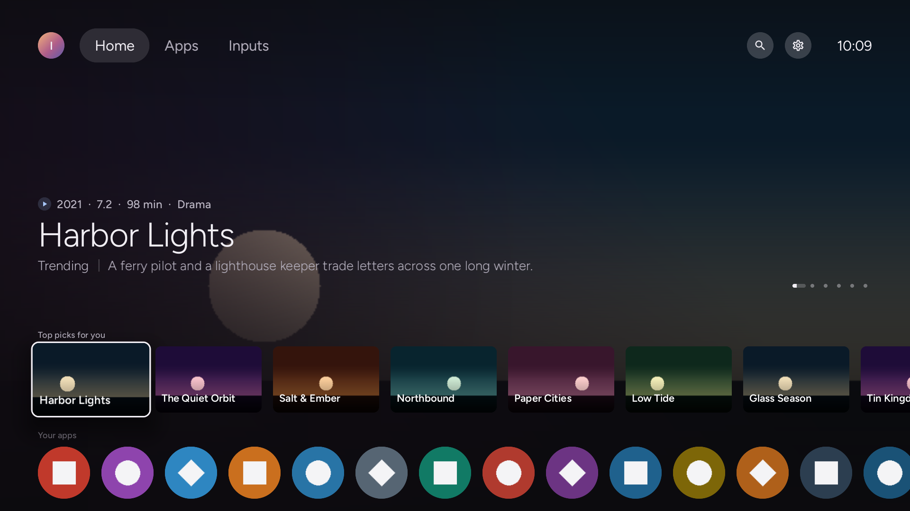
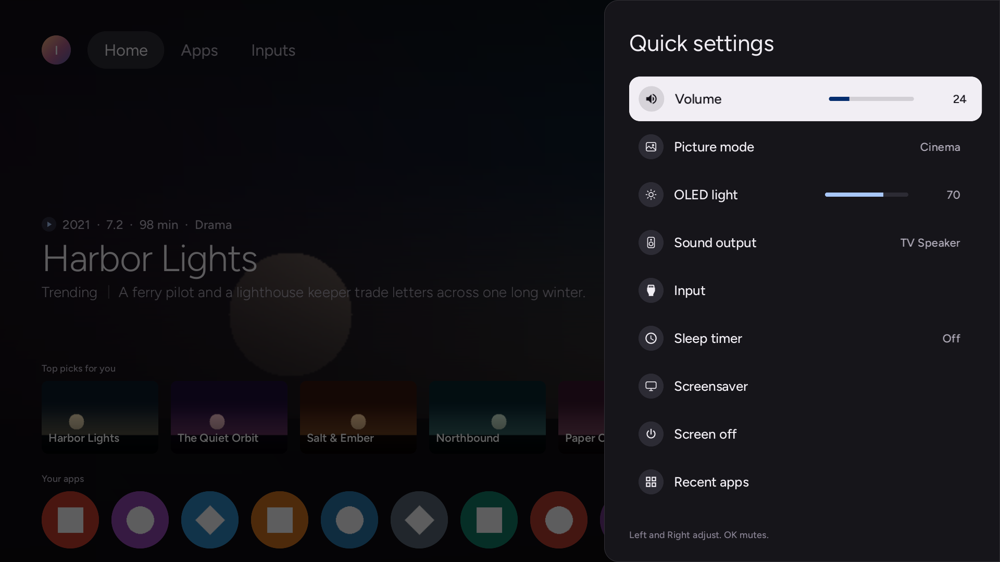

<h1 align="center">Native Tv</h1>

<b>Your TV, your rules.</b> An open-source dashboard, privacy toolkit and Home Assistant bridge for rooted LG webOS TVs.

  
  
  
  
  

  <a href="https://ihtisham1211.github.io/native-tv/">Documentation</a> ·
  <a href="https://ihtisham1211.github.io/native-tv/getting-started/install/">Install</a> ·
  <a href="https://ihtisham1211.github.io/native-tv/getting-started/tested-tvs/">Tested TVs</a> ·
  <a href="https://ihtisham1211.github.io/native-tv/integrations/home-assistant/">Home Assistant</a> ·
  <a href="https://github.com/ihtisham1211/native-tv/issues">Issues</a>

**Native Tv** is a server that runs directly on a rooted LG webOS TV. It gives the TV a live browser dashboard for any phone or computer, a native app on the TV itself, and an MQTT bridge for Home Assistant and other smart-home software.

Use it to control an LG OLED or LCD TV without the cloud, see and switch off what LG's ACR (Live Plus), ad tracking and data agreements collect, block LG's ad and telemetry servers, debloat apps and background services, remap the remote's buttons, protect an OLED panel from burn-in, and read the TV's hardware telemetry.

  
  

> [!NOTE]
>
> ## The TV belongs to its owner.
>
> Native Tv is for owners who do not want a network-connected appliance used as
> a platform for advertising, telemetry and vendor-controlled experiences. It
> brings control, visibility and automation back to the device: ways to remove
> ads, withdraw from agreements and services that monetise the owner's data,
> and a simpler TV, with customisation and local smart-home integration.
>
> Native Tv itself is local and transparent, and needs no cloud service. It
> collects no data, shows no ads and has no dark patterns.

## Features

* **[Control without the cloud](https://ihtisham1211.github.io/native-tv/dashboard/control/).** D-pad, volume, playback keys, app launcher, picture presets, sound output routing, power and reboot, from any browser.
* **[Privacy: see what the TV collects, and switch it off](https://ihtisham1211.github.io/native-tv/dashboard/privacy/).** Whether LG's content-recognition engine is running, the advertising identifier, and every recorded data agreement, most of them switchable. An on-TV blocker for LG's ad and telemetry endpoints, and a switch for the two diagnostics services that upload to LG. [What LG's ACR does](https://ihtisham1211.github.io/native-tv/administration/acr/).
* **[Debloat and home screen cleanup](https://ihtisham1211.github.io/native-tv/dashboard/apps/).** Install apps from the Homebrew Channel catalogue, uninstall LG apps to reclaim flash storage, disable background system services to free RAM and CPU, hide built-in apps from the launcher, and on webOS 9 strip LG's Home screen down to apps and inputs.
* **[Admin PIN](https://ihtisham1211.github.io/native-tv/administration/security/).** A four-digit PIN, asked in the TV's first-run setup, guards installing and removing apps, SSH keys, restoring a backup and power actions, on the TV and in the dashboard; a browser without the access token signs in with it.
* **[Remote button remapping](https://ihtisham1211.github.io/native-tv/dashboard/apps/#remote-keys).** Point Netflix, Prime Video, Guide, the colour keys and other shortcut buttons at any app, an HDMI input or Live TV. The change survives reboots.
* **[OLED care](https://ihtisham1211.github.io/native-tv/dashboard/oled-care/).** Panel hours, compensation cycle progress, Pixel Refresher scheduling and failure alerts, and switches for screen shift, logo dimming, ASBL and Global Stress Reduction, which are normally reachable only from the service menu.
* **[Home Assistant and MQTT](https://ihtisham1211.github.io/native-tv/integrations/home-assistant/).** The TV appears as one device through MQTT Discovery, with controls, telemetry and [remote button events](https://ihtisham1211.github.io/native-tv/integrations/home-assistant-remote-buttons/) for automations. The same topics work for any MQTT client.
* **[Monitoring](https://ihtisham1211.github.io/native-tv/dashboard/metrics/).** SoC temperature, per-core CPU load, memory, swap, Wi-Fi signal and throughput; [Prometheus metrics](https://ihtisham1211.github.io/native-tv/integrations/prometheus/) and [syslog forwarding](https://ihtisham1211.github.io/native-tv/integrations/syslog/).
* **[Screen savers](https://ihtisham1211.github.io/native-tv/dashboard/screen-savers/) and [the service menu](https://ihtisham1211.github.io/native-tv/dashboard/service-menu/).** A clock, starfield, fireworks or the TV's own readings in place of LG's screen saver; LG's engineering menu opened from a browser, with no service remote, and unlocked where newer firmware cuts it down.
* **[A native TV app](https://ihtisham1211.github.io/native-tv/apps/tv-app/).** A C++ and OpenGL ES client after Google TV's design puts the same readings and controls on the TV, driven by the remote, and offers [Native Tv Home](https://ihtisham1211.github.io/native-tv/dashboard/home/) as a replacement home screen. It is drawn on the GPU at the display's 60 frames a second with no browser behind it; on the test TV, under a heavy load, [frames arrive 15 to 18 ms apart](https://ihtisham1211.github.io/native-tv/apps/tv-app/#how-smooth-it-is).

## Screenshots

  
  
  

  
  
  

The dashboard shots come from the repository's TV emulator, so the readings are stand-in values. The TV app shots are rendered by the test suite from sample data.

## Install

Native Tv installs over SSH from a computer on the same network as the TV. The TV needs no internet access.

1. Root the TV and install the [Homebrew Channel](https://github.com/webosbrew/webos-homebrew-channel).
2. Clone this repository on the computer: `git clone https://github.com/ihtisham1211/native-tv.git`.
3. Build the ARM server and TV app with the [webOSbrew native SDK](https://github.com/webosbrew/native-toolchain): `python3 native-tv/build.py --sdk /path/to/arm-webos-linux-gnueabi_sdk-buildroot`.
4. Run `native-tv/lifecycle/deploy.sh <tv-ip>` from the repository root.
5. Open `http://<tv-ip>:8080/` in a browser.

The [installation guide](https://ihtisham1211.github.io/native-tv/getting-started/install/) has the details and troubleshooting. To try the dashboard without a TV, build the host version with `python3 native-tv/build.py --service-only` and run `node scripts/emulate-tv.js`.

## Compatibility

| | |
| :-- | :-- |
| **webOS** | 4 and later. webOS 2.2 and 3.x ran the earlier Node release and are not supported by the native server |
| **Verified with this server** | LG B3 (OLED65B3PUA), webOS 10.3.2. Other models and versions are untried |
| **Reports from the earlier release** | 48 TVs across 33 series, 2015 to 2026 models, webOS 2.2 to 11 ([the table](https://ihtisham1211.github.io/native-tv/getting-started/tested-tvs/)) |
| **Panels** | OLED (panel wear telemetry and burn-in controls) and LCD (the OLED Care tab hides itself) |
| **Access** | Rooted, with the Homebrew Channel; SSH or telnet |

LG names its versions two ways; [webOS version numbers](https://ihtisham1211.github.io/native-tv/getting-started/tested-tvs/#webos-version-numbers) gives both.

## FAQ

**How is ACR (Live Plus) turned off on an LG TV?**
The Privacy tab shows whether LG's content-recognition engine is running and switches it off, with the advertising identifier, ad tracking and the data agreements recorded on the TV. [What LG's ACR does](https://ihtisham1211.github.io/native-tv/administration/acr/) sets out what it samples and which controls act on it.

**Does Native Tv root the TV?**
No. The TV has to be rooted first, and Native Tv installs through the [Homebrew Channel](https://github.com/webosbrew/webos-homebrew-channel)'s SSH or telnet access.

**Does it need a cloud account or internet access on the TV?**
No. It runs on the TV, serves the dashboard on the local network, collects no data and shows no ads.

**How does it connect an LG TV to Home Assistant?**
Through an MQTT broker. The TV publishes itself with MQTT Discovery as one device with its controls and telemetry, and the remote's buttons can fire automations. [Setup](https://ihtisham1211.github.io/native-tv/integrations/home-assistant/) and the [entity list](https://ihtisham1211.github.io/native-tv/integrations/home-assistant-entities/) are in the docs.

**Does it work on LCD and non-OLED LG TVs?**
Yes. The dashboard, controls and telemetry work on LCD panels; the OLED Care tab hides itself.

**Is the TV app smooth, or does it lag like a slow home screen?**
It is a native OpenGL ES client, not a web page, and it draws at the display's 60 Hz. On an LG B3 with the processor busy (load average about 32) its frames arrive 15 to 18 ms apart, against 16.7 ms ideal. [How it stays smooth](https://ihtisham1211.github.io/native-tv/apps/tv-app/#how-smooth-it-is) lists the reasons and the measurement.

**What does it change on the TV?**
[What it changes on the TV](https://ihtisham1211.github.io/native-tv/administration/tv-changes/) lists every change and how each is undone. The read-only system partition is left untouched.

## Documentation

* [Installing](https://ihtisham1211.github.io/native-tv/getting-started/install/), [tested TVs](https://ihtisham1211.github.io/native-tv/getting-started/tested-tvs/) and [updating and uninstalling](https://ihtisham1211.github.io/native-tv/getting-started/managing/)
* [The dashboard](https://ihtisham1211.github.io/native-tv/dashboard/), tab by tab, and [the TV app](https://ihtisham1211.github.io/native-tv/apps/tv-app/)
* [Home Assistant](https://ihtisham1211.github.io/native-tv/integrations/home-assistant/), [Prometheus](https://ihtisham1211.github.io/native-tv/integrations/prometheus/) and [syslog](https://ihtisham1211.github.io/native-tv/integrations/syslog/)
* [Security](https://ihtisham1211.github.io/native-tv/administration/security/) and [what it changes on the TV](https://ihtisham1211.github.io/native-tv/administration/tv-changes/)
* [Internals](https://ihtisham1211.github.io/native-tv/development/implementation/) and [TV research](https://ihtisham1211.github.io/native-tv/development/tv-research/)

The pages are built from [docs/](docs/), so they can also be read there.

## Security

The dashboard has **no authentication by default**, for frictionless control from any phone or browser on a trusted local network. **Never expose port 8080 directly to the internet (do not port-forward).** [Security](https://ihtisham1211.github.io/native-tv/administration/security/) covers the token, closing the port to the network, and MQTT. Vulnerabilities are reported as set out in [SECURITY.md](SECURITY.md).

## Contributing

Native Tv is MIT-licensed and open to contributions. [Contributing](CONTRIBUTING.md) explains how to build, test and open a pull request. Bugs and ideas go in the [issues](https://github.com/ihtisham1211/native-tv/issues). Everyone taking part follows the [Code of Conduct](CODE_OF_CONDUCT.md).

## Disclaimer

**Use this software at your own risk.**

* **Root access and hardware.** This runs custom software with `root` privileges on an embedded TV OS. It is designed to be lightweight and to leave the read-only rootfs untouched, but the author accepts **no responsibility** for damage, bootloops, bricked devices, voided warranties, data loss or panel issues.
* **Power and control commands.** Reboot, power off, screen blanking and Pixel Refresher scheduling issue low-level `luna-send` calls. Understand what each does before using it.
* **Trademarks.** An independent, unofficial community project, not affiliated with or endorsed by LG Electronics. webOS is a trademark of LG Electronics.
* **Third-party components.** Fonts, icons and libraries keep their own licences, listed in [THIRD-PARTY-NOTICES.md](THIRD-PARTY-NOTICES.md).

## License

MIT. See [LICENSE](LICENSE).

## Credits

Native Tv grew out of [Glasshouse](https://github.com/rorygallagher2024/glasshouse) by Rory Gallagher, released under the MIT licence; his copyright notice is kept in [LICENSE](LICENSE). Bundled third-party work, with its licence ([THIRD-PARTY-NOTICES.md](THIRD-PARTY-NOTICES.md) has the texts):

* [CivetWeb](https://github.com/civetweb/civetweb): the HTTP server (MIT)
* [json-c](https://github.com/json-c/json-c): JSON, from the webOSbrew SDK (MIT)
* [NanoSVG](https://github.com/memononen/nanosvg): SVG rendering on the TV (zlib)
* [QR Code generator](https://www.nayuki.io/page/qr-code-generator-library) by Project Nayuki: the QR codes (MIT)
* [StevenBlack/hosts](https://github.com/StevenBlack/hosts): the advertising hosts reviewed for the blocker (MIT)
* [Roboto](https://github.com/googlefonts/roboto-3-classic) and [Figtree](https://github.com/erikdkennedy/figtree): fonts (Apache-2.0, OFL-1.1)
* [Material Design Icons](https://pictogrammers.com/library/mdi/) and [Material Symbols](https://fonts.google.com/icons): icons (Apache-2.0)
* [Dashboard Icons](https://github.com/homarr-labs/dashboard-icons): the brand logos of the app icons (Apache-2.0)
