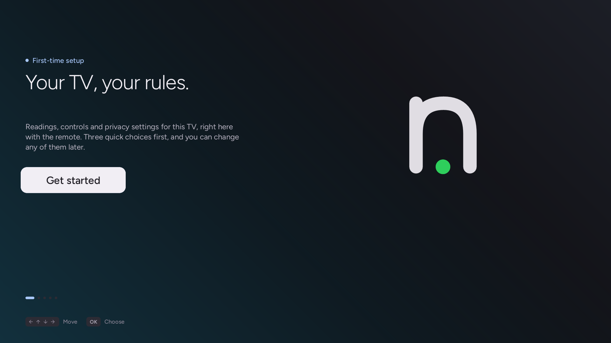
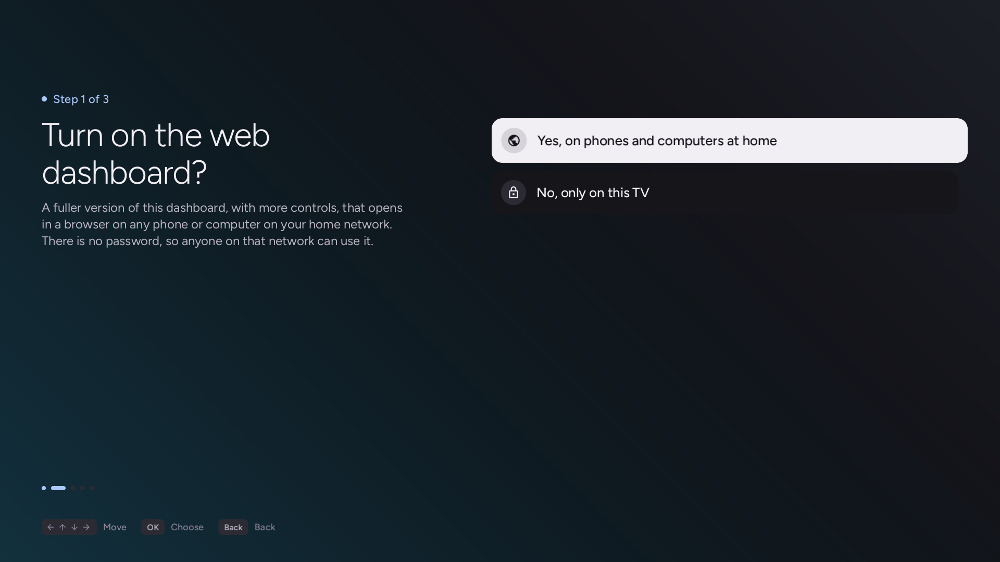
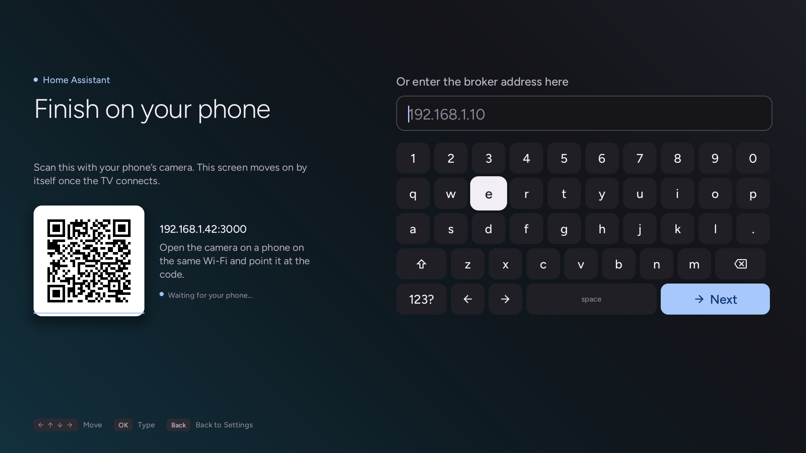
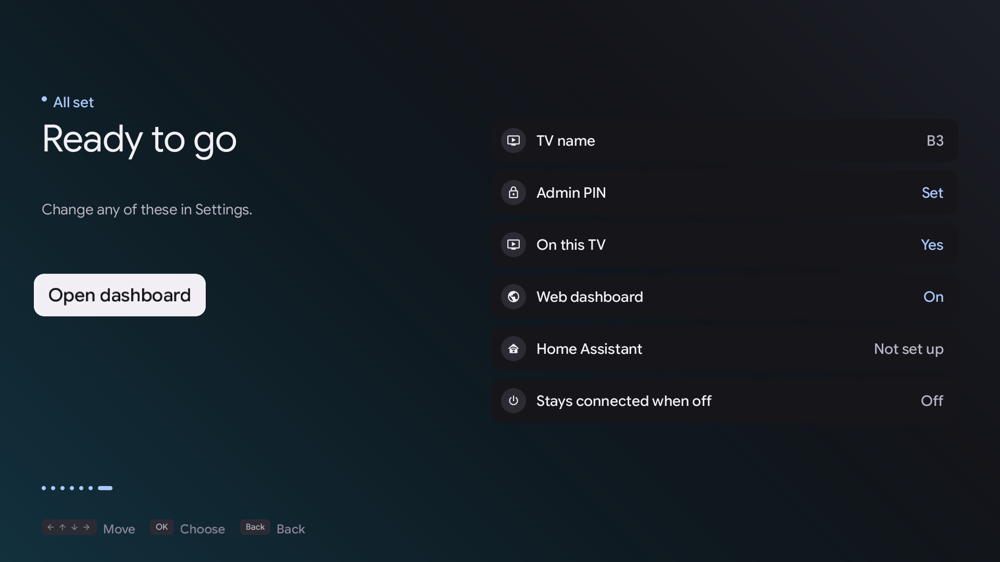

# The TV app

The dashboard can also run directly on the TV's home screen, driven by the remote, for when there is no phone or laptop to hand.

It is drawn by the Native Tv client in the style of Google TV: a dark page with one accent colour, cards that lift and glow when they are focused, and a top bar with the profile, the tabs and the clock. The pages below are its own screens, not web pages.

Because the panel is an OLED, no screen of the app holds still at full brightness: thirty seconds without a key or a click dim it to two thirds black, and the first key or click after that only wakes it. This holds for Home, Live, Settings, the catalogue and the setup pages alike; the TV's own screen saver is left as it is set.

### Live

The **Live** tab is the TV's own readings as cards: the processor's load with a line of its recent readings, memory and swap, the SoC temperature, the Wi-Fi link and the rate in and out, how long the TV has been up, the panel's hours and when its pixel refresher is due, and the input in front with its resolution, refresh rate, HDR and VRR. It reads the server every four seconds while it is open: numbers count to their new value and the bars grow, instead of jumping. OK reads at once, and Back leaves for Home. A card that has no reading on a TV, such as the thermal sensor on one that has none, shows a dash. Until the first reading arrives, a thin turning arc with a short label stands in for the cards.

### Settings

**Settings** is two panes that are always on screen: the dashboard's ten sections (Metrics, Apps, OLED Care, Game, Screen Saver, Home, Privacy, Service Menu, System and Settings) in a list on the left, a third of the width, and the focused section's page on the right. A section that this TV does not have, such as OLED Care on an LCD, is left out. Moving through the list shows each section's page beside it at once. Each page is split into named subsections of a few rows (Apps has Installed, Home screen, Quick Access, System apps, Kept ready and Services), shown as a row of pills above the rows, with only the chosen subsection's rows below. Under the rows, a panel says what the focused row is and what OK does to it. Settings are switches, which slide when they change, values that OK steps to the next of, actions, and links that open another page.

* **Up / Down**, or the Magic Remote's wheel: in the list, another section; in the page, through the rows, skipping section headings; from the first row, up to the subsection pills.
* **Right** or **OK** in the list: into the page. **Left** or **Back** in the page: back to the list. **Back** in the list: close Settings. **Left** and **Right** never change the section.
* **Left / Right** on the pills: the previous or next subsection; **Down** returns to the rows. A section opens on the subsection it was left on.
* **Channel Up / Channel Down** (or **Page Up / Page Down**): jump 6 rows.
* **OK**: change the row. A change that is hard to undo, such as switching an OLED protection off, uninstalling an app, powering off or resetting a layout, asks for a second OK within five seconds, and Back cancels it.
* **Back**: close a list inside a section (Privacy's consents, Home's channels), then return to the list, then close Settings.
* **Magic Remote pointer**: clicking a row selects it and clicking it again acts on it.

A change shows the moment OK is pressed: the switch has already slid and a faint dot says it is on its way. It is sent to the same server routes as the browser dashboard behind the page, and the section is read again afterwards. A refusal puts the old value back and says why. Metrics and System refresh every ten seconds while open; a refresh keeps the focused row, the subsection and the scroll where they were. The first read of a section shows a thin turning arc where its rows will be. Opening or closing the web dashboard to the network restarts the server: the row reads "Switching…" and the page waits until the server answers again.

### First-run setup wizard

Opening the TV app on a fresh install starts an on-screen setup wizard to configure the TV in a few quick steps with the remote. Whatever the app is opened on (its tile, Home, or a Settings page), it first asks the server whether first-run setup is done, as the browser dashboard always did, and opens the wizard's welcome page when it is not; the first frames wait behind the dark cover for the answer, and a server that is still starting is asked again every two seconds.

1. **Name this TV**: The keyboard comes up with the name the TV's model gives it: `B3` on an OLED65B3PUA, `C2` on an OLED42C24LA, `UQ8000` on a 55UQ8000, `LGTV` when the model is not known. OK on **Next** keeps it, or type another name. It is the name of the main profile on Home, which the profile editor can change later, and it shows on the summary at once; if the server refuses it, the old name comes back with a message.
2. **Web dashboard access**: Choose between opening the web dashboard to devices across your home network or keeping it private to this TV only (`127.0.0.1`).
3. **Home Assistant integration**: Connect your TV to Home Assistant via MQTT. The TV displays a QR code to scan with your phone, allowing you to enter MQTT broker details easily without typing credentials on the remote. Beside the code is an on-screen keyboard for typing the broker's address, port, user and password with the remote instead, one field after another; Back returns to the previous field, and the TV shows when the broker has connected.
4. **Active Standby (Always-on)**: On TVs with Always Ready support (such as LG C2 or G2), choose whether Native Tv and Home Assistant remain connected with the screen off so the TV can be controlled and turned back on over the network.
5. **Summary**: Review your setup and open the dashboard with a single click.

The choices show as made the moment OK is pressed and are written behind the page (a refusal puts the old answer back and says so); only the dashboard network choice, which restarts the server, and the phone link wait for the server, and say so with a breathing dot and "Saving…". A row of dots at the bottom of each page shows how far along the wizard is, and a line of key hints sits under it. Left or Back returns to the previous step, as it always did; Back on the welcome page leaves setup, which then starts again the next time the app opens. When the app is opened from **Settings** to connect Home Assistant, only the phone link and the keyboard appear and Back returns to Settings.

All choices made during setup can be changed at any time from the TV app's **Settings** or the web dashboard.

*The setup wizard welcome screen.*

*Choosing whether the web dashboard is open to devices on the home network or TV-local only.*

*Scanning the phone handoff code to configure Home Assistant without typing on the remote.*

*The final summary screen confirming your settings before opening the dashboard.*

> [!TIP]
> **Testing the setup wizard**: To test or verify the setup flow without modifying TV settings, start the server with the `--emulate-setup` flag, or open the web dashboard in a browser with `?setup=1`.

### Pairing and settings

In Settings, the **Settings** section gives the web dashboard's address, with a QR code to scan on a phone (OK on the address), and the TV's DNS name under it where the home network's DNS has one. Opening the web dashboard to the network or closing it restarts the server, and the TV app waits until it answers again.

Scanning the code automatically pairs the phone with the TV, passing the access token if one is configured, allowing the dashboard to be opened without typing an IP address with the remote.

### Installing apps and system app hiding

The **Apps** section lists the apps installed from outside LG's store, each with an uninstall that takes a second OK, the parts of LG's Home screen and the inputs shown on it, the keys of Quick Access, the system apps that can be hidden, the apps LG keeps ready in the background, and the background services that can be turned off.

**Install homebrew apps** opens the catalog: the Homebrew Channel's apps as a grid of tiles, updates first and then by title, each marked Update, Installed or Homebrew Channel, with the focused app's version, size and description under the grid. OK on a new app or an update has the server fetch and check it, and then shows what it would change: the version, the background services, free space, whether the app asks to run its services as root (a switch, offered only for packages the Homebrew Channel has vetted), and whether it replaces a version from LG's store. Nothing is installed until OK on **Install**; **Cancel**, or Back, throws the download away. While it runs, a progress card replaces the page and Back waits for it to finish; the result then says what was installed or why it failed. OK on an installed app uninstalls it after a second OK; the tile is dimmed and reads Removing… until the TV answers, and comes back if it refuses. The first load of the catalogue shows a thin turning arc.

### Native Tv Home

The **Home** section sets up [Native Tv Home](../dashboard/home.md) from the TV, as the browser dashboard's Home tab does, and is left out on a TV Native Tv Home is not offered on. It has the on/off switch (a second press confirms), a way to open Native Tv Home while it is on, the order of its rows, then a section for each row in that order: each row's Order (Your order or Last opened), apps and inputs each shown or hidden, and the channels added, each removed with OK, with **Add channels** listing the TV's channels not yet on Home. Then whether wallpapers are uploaded (they are uploaded from the browser dashboard), and **Reset the layout**. Moving tiles within a row is done on Native Tv Home itself, by holding OK.

### Sleep timer and power

The **System** section has the sleep timer under **Timers**: each press of OK moves it to the next of 10, 30, 60, 90 and 120 minutes, then off. Its **Power** section, last in the tab, has **Power off** and **Reboot**, the full restart the browser dashboard's Control tab offers. Each takes a second press of OK within five seconds, and warns first while an app is installing. Both are left out when `allowPower` is false in `config.json`, as on the browser dashboard.

### Adding and removing the app

A first install of Native Tv adds the app to the TV's home screen; updating an existing install leaves the home screen alone. The app is the Native Tv client itself, opened on the dashboard screen, and it is brought up to date with the server at each start of the server.

The app can be added or removed at any time:

* **From the web dashboard**: Go to the **Server** tab and toggle the TV app.
* **From deploy.sh**: Pass `--app` to add it or `--no-app` to omit it during installation.

[Native Tv Home](../dashboard/home.md) is this same app opened on its Home screen, so it needs the app on the home screen: with the app removed Home cannot be switched on, and Home that is on gives LG's Home back. Removing the app changes nothing else, since the dashboard server continues to run in the background and reaches any browser on the network regardless. Where a TV model will not take the app, the control is hidden and everything else works as before.
