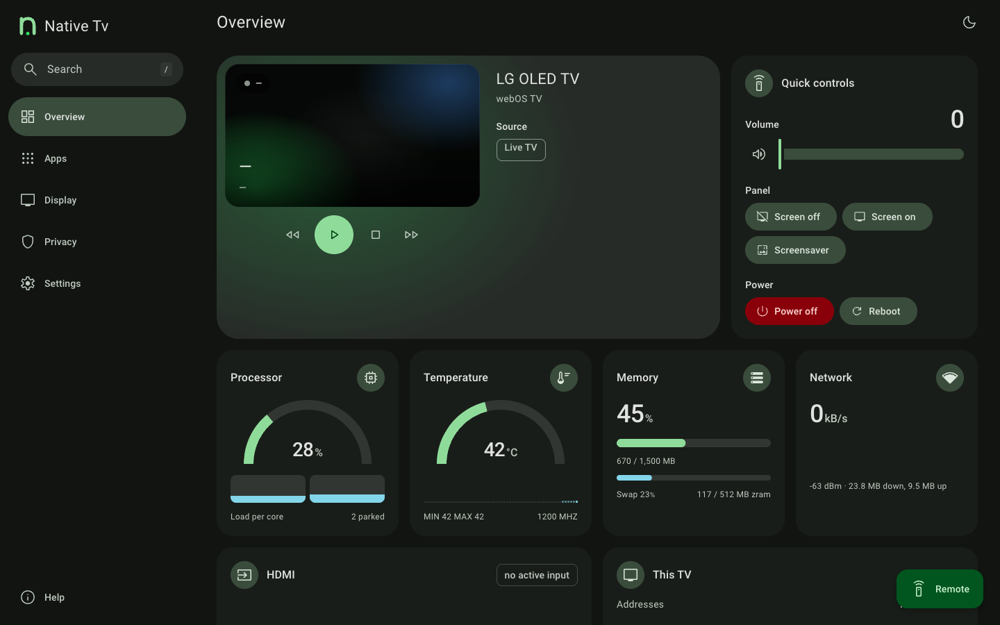

# Control

The **Control** tab, `/?tab=control`, is the top of the **Overview** section, above the [Metrics](metrics.md) readings. It turns the TV into a locally controlled device over the home network, operating directly with webOS without relying on LG's cloud services or mobile applications.

## Navigation and playback

* **D-pad navigation:** the **Remote** button, bottom right on every screen, opens a sheet with the directional arrows (Up, Down, Left, Right), OK/Select, Back, Home and Settings (LG's quick settings) to navigate webOS menus and built-in interfaces.
* **Keyboard:** while the Remote sheet is open, a computer's keyboard works as the remote: the arrow keys, Enter for OK, Esc or Backspace for Back, H for Home, M for Settings, Space for play or pause and K for mute. Keys typed into a field, or pressed with Ctrl, Alt or Cmd, are left to the page.
* **Typing on the TV:** under the arrows, the Remote sheet has a box that types into the text field the TV has open, such as an app's search or a sign-in. **Send** types the text at the cursor, **Delete** removes the last character and **Enter** presses Enter, so a long title or a password need not be spelled with the arrows. Text is up to 256 characters, with no line breaks. When no text field is open the TV refuses, and the box keeps the text and says so. It needs `allowControl`, and goes through `POST /api/keyboard` for other tools.
* **Media playback:** Dedicated transport controls (Play/Pause, Stop, Rewind, Fast Forward) under the picture preview.
* **Volume and mute:** Volume slider, precision step buttons beside it where the sound output takes only steps, and a one-click mute toggle.
* **Source selection:** One-click switching across active TV inputs, including HDMI ports and Live TV, with a tick marking the current display source. The preview above it names what is on screen, with its signal.

## Picture and sound

* **Picture mode presets:** Instant switching between calibrated picture modes (such as Cinema, Filmmaker, ISF Expert, Game Optimizer). The presets offered adapt dynamically to what is currently playing, displaying Dolby Vision presets for Dolby Vision content and HDR presets for HDR signals.
* **OLED light and backlight:** Live slider adjusting the panel luminance level for the active picture mode.
* **Energy saving:** Quick toggles for Auto, Off, Minimum, Medium, Maximum, and Screen off energy-saving states.
* **Sound output routing:** Switch audio output between TV Speaker, HDMI ARC, Optical, Headphone, and Bluetooth.

## Panel, timers and power

* **Screen blanking:** **Screen off** turns off the OLED or LCD panel immediately while audio and background services continue running. **Screen on** or any remote interaction restores the picture.
* **Screensaver:** Triggers the configured screensaver directly on the TV.
* **Sleep timer:** Sets a timed shutoff (Off, 10, 30, 60, 90, or 120 minutes).
* **Power and reboot:** Switches the TV between standby and on, or performs a full operating system reboot.

## Apps and remote tools

* **App launcher:** Launch installed webOS applications directly from the dashboard grid.
* **Remote tools & utilities:** Collapsible section grouping quick on-screen actions:
  * **Screen notifications:** Send instant on-screen toast notifications (up to 120 characters) to display messages on the TV.
  * **Open a web page:** Enter any HTTP or HTTPS URL to launch it immediately in the TV's native web browser.

*The controls at the top of the Overview, with the Metrics readings starting under them.*

