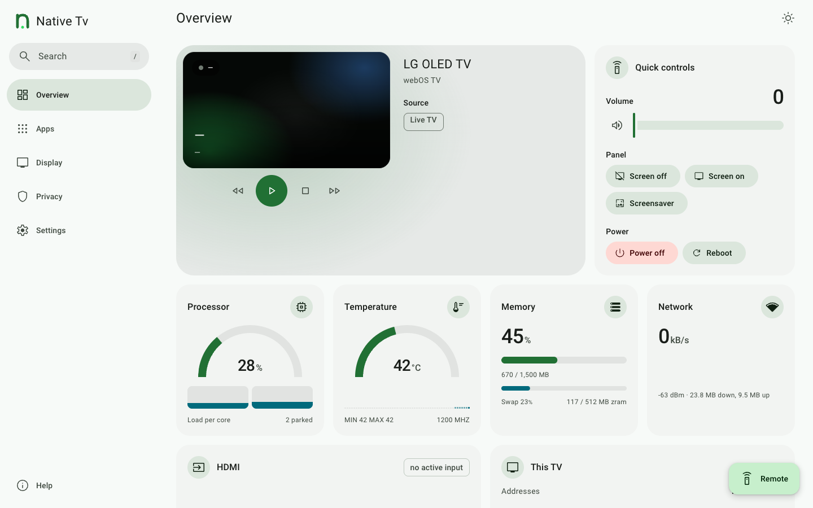

# The dashboard

The dashboard has five sections, and tabs inside three of them. Each tab has a deep link, `/?tab=` and its name below, and the links of earlier releases (`control`, `metrics`, `system`) still open the right place. OLED care appears on OLED TVs only, and Game mode and Native Tv Home where the TV offers them.

The sections are a bar along the bottom on a phone, a rail down the left on a tablet and a drawer down the left on a computer. The keys **1** to **5** open them. The **Remote** button, bottom right on every screen, opens the D-pad and the remote's keys.

* **Overview**: [Control](control.md) and [Metrics](metrics.md) together, as one screen: what the TV is showing, the volume and power, then the readings
* **Apps**: [Installed](apps.md) (`apps`), [Catalogue](apps.md#install-homebrew-apps) (`catalogue`), [Home screen](apps.md#home-screen-and-remote) (`homescreen`) and [Native Tv Home](home.md) (`home`)
* **Display**: [OLED care](oled-care.md) (`oledcare`), [Screen savers](screen-savers.md) (`screensaver`) and [Game mode](game.md) (`game`)
* **Privacy**: [Privacy](privacy.md), screen recognition, ad tracking, data agreements and the blocker
* **Settings**: [Home Assistant](../integrations/home-assistant.md) (`mqtt`), [Server and backup](server.md) (`server`), [Tools and logs](tools.md) (`tools`), [Advanced](advanced.md) and the [Service menu](service-menu.md) (`servicemenu`)

For the app on the TV's home screen, see [The TV app](../apps/tv-app.md).

The page works with no internet access. It follows the system's light or dark setting; the button at the top right steps through Auto, Dark and Light, and `/?theme=light` or `/?theme=dark` sets it for the visit. The choice is kept in the browser.

Use the search button (at the top of the drawer on a computer, in the top bar elsewhere), or press `/` or `Ctrl`/`Cmd` + `K`,
to find sections, settings, controls, and installed apps. Useful destinations can be pinned
with the star beside a search result, keeping shortcuts to them in the drawer.

## In both themes

*The Overview screen in the dark and light themes.*
