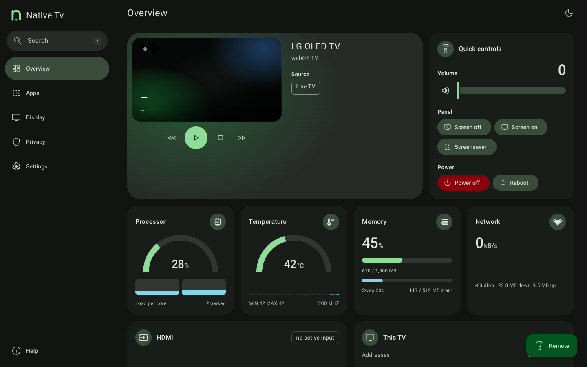
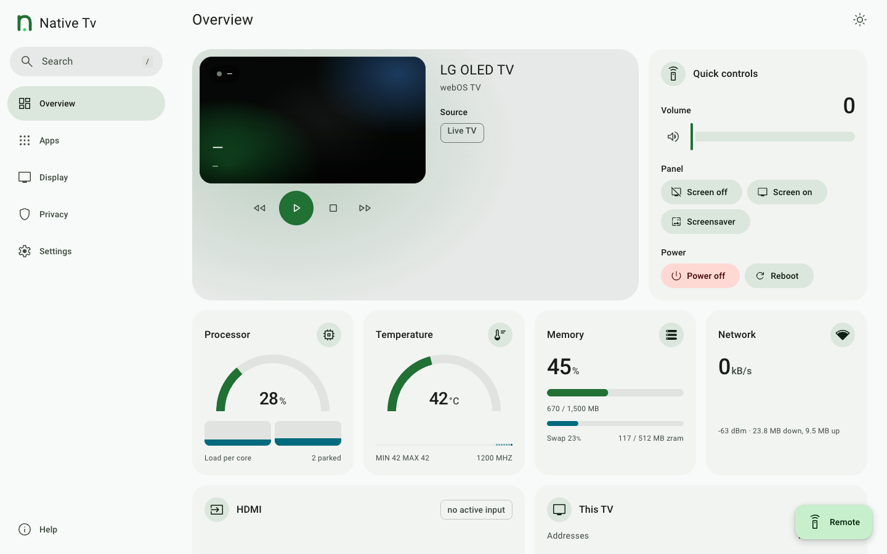

# The dashboard

The dashboard has five sections, and tabs inside three of them. Each tab has a deep link, `/?tab=` and its name below, and the links of earlier releases (`control`, `metrics`, `system`) still open the right place. OLED care appears on OLED TVs only, and Game mode and Native Tv Home where the TV offers them.

The sections are a bar along the bottom on a phone, a rail down the left on a tablet and a drawer down the left on a computer. The keys **1** to **5** open them. The **Remote** button, bottom right on every screen, opens the D-pad, the remote's keys and a box to type into the TV's text fields.

* **Overview**: [Control](control.md) and [Metrics](metrics.md) together, as one screen: what the TV is showing, the volume and power, then the readings
* **Apps**: [Installed](apps.md) (`apps`), [Catalogue](apps.md#install-homebrew-apps) (`catalogue`), [LG launcher](apps.md#lg-launcher-and-remote) (`homescreen`) and [Native Tv Home](home.md) (`home`)
* **Display**: [OLED care](oled-care.md) (`oledcare`), [Screen savers](screen-savers.md) (`screensaver`) and [Game mode](game.md) (`game`)
* **Privacy**: [Privacy](privacy.md), screen recognition, ad tracking, data agreements and the blocker
* **Settings**: [Home Assistant](../integrations/home-assistant.md) (`mqtt`), [Server and backup](server.md) (`server`), [Tools and logs](tools.md) (`tools`), [Advanced](advanced.md) and the [Service menu](service-menu.md) (`servicemenu`)

For the app on the TV's home screen, see [The TV app](../apps/tv-app.md).

The page works with no internet access. It follows the system's light or dark setting; the button at the top right steps through Auto, Dark and Light, and `/?theme=light` or `/?theme=dark` sets it for the visit. The choice is kept in the browser. The dashboard is in English and Spanish: it follows the browser's language, and the Language setting on the [Server tab](server.md#native-tv) or `/?lang=es` or `/?lang=en` changes it.

Use the search button (at the top of the drawer on a computer, in the top bar elsewhere), or press `/` or `Ctrl`/`Cmd` + `K`,
to find sections, settings, controls, and installed apps. Useful destinations can be pinned
with the star beside a search result, keeping shortcuts to them in the drawer.

## Install as an app

The dashboard can be added to a phone's home screen or a computer's app list, where it opens in its own window with the Native Tv icon and no address bar: **Install app** in Chrome's menu, or **Share**, then **Add to Home Screen** in Safari on iOS. It opens `/`, so it signs in as the browser does: where the TV has a token and the app has none stored, it asks for the passcode.

A browser offers no service worker on the TV's own address, `http://<tv>:8080`, which is not a secure origin, so there the page has only its manifest and icons, and the browser decides whether to install it or add a shortcut. Behind HTTPS (a reverse proxy in front of the TV) or on `localhost`, the service worker registers and Chrome offers the install. With the TV off or out of reach, the app then shows a "Can't reach the TV" page with a **Try again** button, in English only, in place of the browser's error page. The worker caches nothing: the page and every reading still come from the TV.

## In both themes

*The Overview screen in the dark and light themes.*
