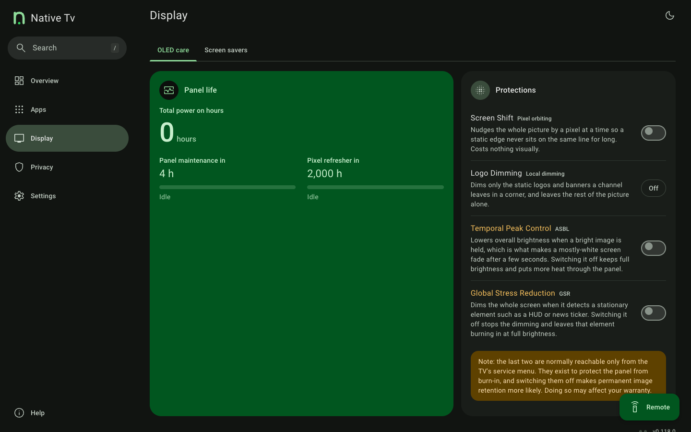

# OLED wear and burn-in protection

The **OLED care** tab of the **Display** section, `/?tab=oledcare`, brings together the panel's own wear figures with the protections that affect OLED wear.

The aim is not to encourage disabling OLED protections blindly. Instead, the dashboard shows what each control does and exposes the controls that the particular panel makes available.

* Cumulative panel hours, panel maintenance and Pixel Refresher countdowns with scheduling, completed cycle counters and refresher failure alerts.
* GSR stress events on supported panels — counts how many static image stress intervals (such as logos, HUDs, or news tickers) the panel has detected, even if active dimming is switched off.
* Screen shift and logo dimming on any OLED.
* Temporal peak control (ASBL) and global stress reduction on supported models (the two normally reachable only from the TV's service menu, with a service remote and a PIN).

*OLED panel wear information, maintenance cycle progress and burn-in protection controls.*

