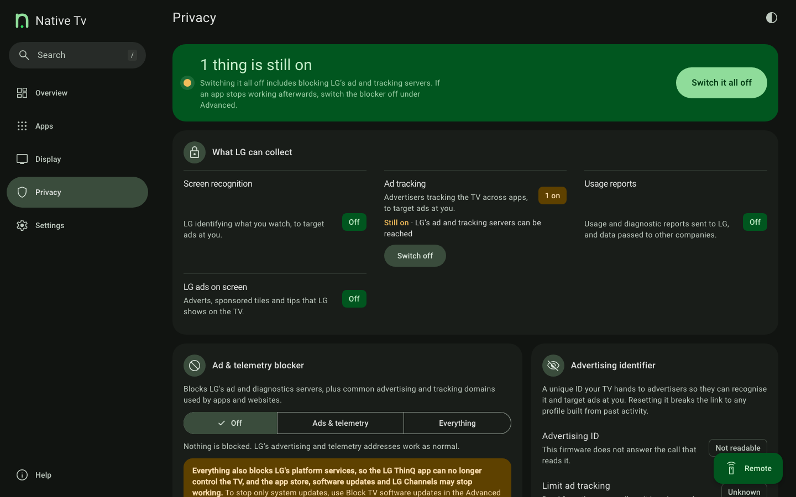

# Privacy and data collection

The **Privacy** section, `/?tab=privacy`, reports what the TV is configured to do rather than hiding these settings behind its normal menus.

It opens with a summary of screen recognition, ad tracking and usage reports, what is still on under each, and a button that switches all of it off while leaving voice alone. Everything below it is the detail.

It shows whether the content-recognition engine is running and sampling frames, the advertising ID and whether ad tracking is limited, recorded data agreements, and toggles to disable LG's background collection and diagnostics services.

Most data agreements can be switched off from here (persisting across reboots), and the advertising ID can be reset and its cookies cleared. Acceptance of new terms is left to the TV's own menus.

On TVs with a microphone switch on the set itself, such as a C5, **What's running now** shows whether that switch is on. It is read from the TV and can only be changed at the switch.

LG's on-screen ads and promotions have their own switches: ads in the screen saver, Sponsored tiles and recommendations on the Home screen, ads while watching, and Smart Tips. Each shows only on TVs that have it. **All LG ads and promotions**, above them (on the TV, on the LG ads page of Privacy), switches all of them at once: it reads on when any of them is on, and pressing it then turns every one off; pressing it with all off turns every one on. A TV that does not report one of them leaves it out of that write.

**Log uploads to LG** has a switch for the debug logs and one for the crash and fault reports the TV may send to LG, which LG's own menus have no switch for (on the TV, on the Data page of Privacy). Each shows only on TVs that report it, and the summary at the top lists one that is on under usage reports. LG's start-up writes debug log upload on again on some TVs (a C5 on webOS 11.2, as measured by [Glasshouse](https://github.com/rorygallagher2024/glasshouse), not by Native Tv; a C2 on webOS 9.2.2 keeps both off), so an off chosen here is recorded and written again 60 seconds after the server starts, each time the TV is switched on and hourly, whenever a read finds it on. Switching it back on hands it back to LG. [What the dashboard changes on the TV](../administration/tv-changes.md#changes-that-stay) says where the record is kept.

The ad & telemetry blocker blackholes LG's tracking, ad and ACR endpoints, plus common advertising and tracking hosts used by apps and websites, on the TV itself. It bind-mounts a hosts table over `/etc/hosts`, and is restored on boot.

Two tiers are available:

* **ads & telemetry** blocks LG's ad, diagnostics and customer-data hosts, the Alphonso screen recognition servers, LG's remote diagnostics servers, the Content Store's request logs, the host LG's over-the-air ad log script reports to, and 79 common advertising and measurement hosts covering Google/DoubleClick, Amazon, Microsoft/Xandr, ad exchanges and app analytics. It leaves LG's service platform reachable. On webOS 11 the diagnostics report upload shares its host with the Content Store, so it stays reachable here; the everything tier takes it.
* **everything** adds the hosts that carry LG's platform services, so on that tier the LG ThinQ app can no longer control the TV, and the app store, software updates, LG Channels, Alexa and LG's search may stop working. It also blocks Home's configuration and recommendation hosts, ThinQ, account and push services, LG Channels' Pluto and Xumo dependencies, Google's push messaging hosts (apps lose push notifications) and, on webOS 11, `tv.wiselg.com`, LG's platform there, which also carries the diagnostics report upload and app usage statistics. (To stop only LG's system updates, use **Block TV software updates** on the [Advanced tab](advanced.md).)

Hosts LG puts a region or the TV's country in front of are blocked bare and for LG's regions (`aic`, `eic`, `kic`, `eu`) and the TV's country, or for a set of countries LG is seen using until the TV has reported its own. The list is exact names, not wildcards, and the Everything tier's names are a reported or inferred coverage rather than a capture of every region's TV: [where each came from](../development/implementation.md#the-blockers-second-tier-takes-lgs-own-platform-with-it).

After a power cut the TV is left to set its clock from LG's time servers, `nextlgsdp.com` on webOS 9 and `tv.wiselg.com` on webOS 11, before they are blocked. That covers the everything tier, and the report upload host that the ads tier blocks under `nextlgsdp.com` (the one sdx hands out). If the date is still wrong, apps fail to load or install with certificate errors; setting the time by hand, with **Set Automatically** off under Settings › General › System › Time & Date, fixes that without unblocking anything.

While the table blocks the TV's country's time server, AirPlay pairing keeps working: the TV checks its MFi key with LG through that server at the first pairing after each power-on, and with it blocked the iPhone gave up before the TV did (a B4 on webOS 10.3.2, reported to Glasshouse). The blocker skips that check, and puts it back once the server is reachable again. Lines other tools put in `/etc/hosts`, including other blockers' `0.0.0.0` lines, are kept when the table is rewritten.

If an app or one of LG's services stops working while the blocker is on, switch it off to check whether it is the cause.

The common-host list is a compact selection checked against [StevenBlack/hosts](https://github.com/StevenBlack/hosts/blob/0ced9c8a871b668a31fe194f2801d80ee046bf31/hosts), updated with Native Tv releases. The TV does not download lists in the background. Hosts files match exact names, so unlisted subdomains, apps using their own DNS resolver and ads served from the same hosts as the video can get through. This does not promise ad-free YouTube or other streaming services.

**Custom ad blocking**, under the blocking level on the Privacy tab (and as a row of Blocking on the TV app, which says there is no list when there is none), takes a hosts file or a plain list of names from the computer the dashboard is open on. It is a power-user feature: depending on what a list blocks, it can stop apps, LG's services or software updates working.

* **Hosts file**: **Upload a file** sends it; names pointed at `0.0.0.0`, `127.0.0.1`, `::` or `::1`, and lines of one bare name, are taken, and a line pointing a name at any other address is a redirect and is left out, with the count shown. A name needs a dot, so an ordinary text file is refused. Up to 10,000 names and 1 MB. Uploading switches blocking on. **Upload a new file** replaces it, and **Delete** removes it.
* **Block its names** switches the file off without deleting it, to check whether it is what stopped something working.
* **What is blocked**: **Your file and Native Tv's list** blocks the file's names as well as the tier's own; **Only your file** blocks just the file's, so both tiers block the same.

The row shows the file's name, how many names it has and when it was uploaded, and says in place how each action went, with a refusal in the same banner as the page's own errors. The list is blocked only while the blocker is on. The TV keeps it, and Native Tv's own list comes from the version installed, so after an update the names it adds or drops take effect at once and the file is not uploaded again. A name in the file stays blocked when an update drops it from Native Tv's list. LG's time servers in the file are held back after a power cut until the clock is set, as on the everything tier. The TV app shows the list but cannot change it.

**Export the block list**, under the blocking level on the Privacy tab, downloads the names the blocker blocks as a file for another blocker: a **hosts file** (`0.0.0.0` lines) for a router or computer, a **Pi-hole** list (one name per line, for an adlist or domain list) or **AdGuard Home** rules (`||name^`). Routers and DNS blockers then cover every device on the network, and the blocking stays after the TV is reset to factory settings. The file holds the level now chosen, or the ads level while the blocker is off, with a custom file as it is used and LG's software update servers while **Block TV software updates** is on. An AdGuard rule also matches each name's subdomains, which the TV's own hosts table does not. The **everything** tier includes the hosts LG's apps and the ThinQ app depend on, so read the tier's description before putting it on a router; for the ads level alone, switch the blocker to **ads** first. A script can fetch `GET /api/adblock/export?format=hosts|pihole|adguard` (with `&tier=ads` or `&tier=full` to choose the level).

After switching away from **everything**, LG's own apps, such as the Content Store and LG Channels, can take about a minute to connect again: they run in a browser engine that keeps a looked-up address for about a minute. If one shows an error, exit it and open it again after a minute. A restart is not needed.

What ACR collects and what LG Ad Solutions does with it is set out in [What LG's ACR does](../administration/acr.md).

*Privacy controls, data agreements, advertising ID, LG telemetry blocking and custom ad blocking.*
