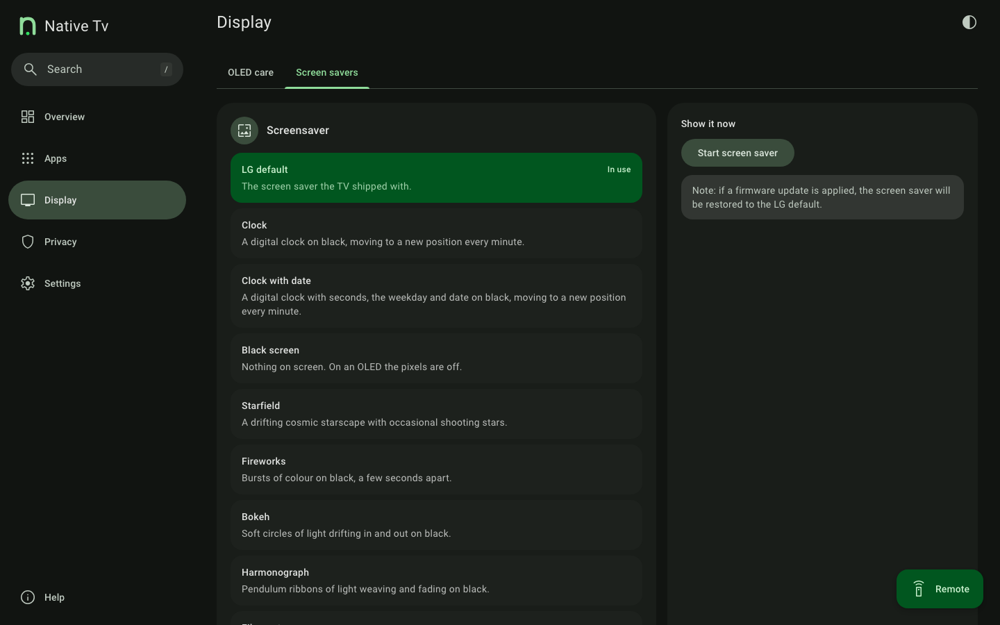

# Screen savers

The **Screen savers** tab of the **Display** section, `/?tab=screensaver`, provides sixteen alternatives to LG's default:

* Clock
* Clock with date, with seconds, the weekday and the date
* Black screen, nothing on screen (on an OLED the pixels are off)
* Starfield
* Fireworks
* Bokeh, soft circles of light drifting in and out
* Harmonograph, pendulum ribbons of light weaving and fading on black
* Filament, swarms of light circling and trailing across black
* Currents, streams of light flowing along a slowly changing wind
* Veils, translucent ribbons of light rippling slowly
* Incense, thin streams of coloured smoke rising and curling
* Murmuration, flocks of light swooping after their leaders
* Vortex, whirlwinds of light spiralling up swaying funnels
* Neo, columns of falling glyphs
* Tesseract, a four-dimensional cube turning in fine lines of light
* Panel vitals, showing the TV's own panel hours and refresher countdown

Each mode but the black screen offers dim and bright variants, and visual elements continuously drift across the screen to prevent OLED burn-in or image retention.

**Start after** is shown on TVs that report LG's screen-saver timer. The **3 minutes**, **10 minutes**, **20 minutes** and **30 minutes** choices use LG's timer. Where Native Tv can watch remote input, the menu also offers **1 minute** and **2 minutes**. These choices ask the TV to start its screen saver after idle time with no playback, and skip HDMI and live TV. The same choices appear under **Options** on the TV app's Screen Saver page.

A firmware update restores the LG default.

On webOS 12 and later they are experimental: the tab shows a switch above the list that turns them on, after a warning, and until then only LG's default can be chosen. See [Experimental features](../administration/experimental.md) for why.

**Start screen saver** asks the TV for its screen saver. Some TVs accept the request and then refuse it; a G3 on webOS 9.2.2 refused every one, its own idle screen saver included. There the dashboard opens the screen saver itself, unless something is playing full screen or playback cannot be checked. Any key on the remote, including Home and the coloured buttons, or a second press of the button closes it. A failed close leaves it tracked so another press can retry. The TV does not know about a screen saver opened this way: its power state stays On, in the dashboards and in Home Assistant, and watch time counts the app beneath it. The Screen Saver sensor does show it.

*The Screen savers tab; the list continues below the fold.*

