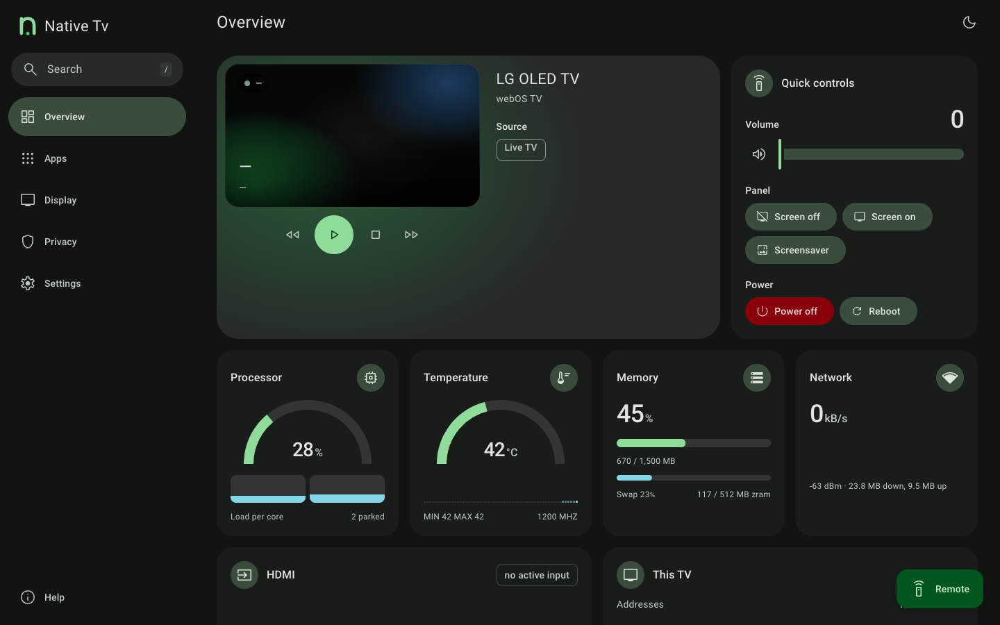
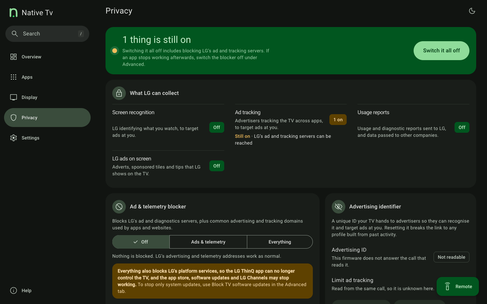

# Native Tv

**Your TV, your rules.** An open-source dashboard, privacy toolkit and Home Assistant bridge for rooted LG webOS TVs.

> [!NOTE]
>
> ## The TV belongs to its owner.
>
> Native Tv is for owners who do not want a network-connected appliance used as
> a platform for advertising, telemetry and vendor-controlled experiences. It
> brings control, visibility and automation back to the device: ways to remove
> ads, withdraw from agreements and services that monetise the owner's data,
> and a simpler TV, with customisation and local smart-home integration.
>
> Native Tv itself is local and transparent, and needs no cloud service. It
> collects no data, shows no ads and has no dark patterns.

Native Tv is a server that runs directly on a rooted LG webOS TV, with a live dashboard for any phone or computer browser and a native app on the TV itself.

[Install](getting-started/install.md){ .md-button .md-button--primary } [See the dashboard](dashboard/index.md){ .md-button }

  
  &nbsp;
  

## What it does

* **[Control the TV without the cloud](dashboard/control.md).** D-pad, volume, playback keys, app launcher, picture presets, sound output, power and reboot.
* **[See what the TV collects, and switch it off](dashboard/privacy.md).** LG's content recognition (ACR, Live Plus), the advertising identifier, data agreements, and an on-TV blocker for LG's ad and telemetry servers. [What LG's ACR does](administration/acr.md).
* **[Debloat and clean up](dashboard/apps.md).** Install Homebrew Channel apps, uninstall LG apps, stop background services, hide system apps from the launcher.
* **[Remap the remote's buttons](dashboard/apps.md#remote-keys).** Point Netflix, Prime Video, Guide and the colour keys at any app, HDMI input or Live TV.
* **[Replace the screen saver](dashboard/screen-savers.md)** with a clock, starfield, fireworks or the TV's own readings.
* **[Protect and monitor an OLED panel](dashboard/oled-care.md).** Panel hours, Pixel Refresher scheduling, and switches for screen shift, logo dimming, ASBL and Global Stress Reduction.
* **[Connect it to Home Assistant](integrations/home-assistant.md).** An MQTT bridge with Discovery exposes the TV as one device; the remote's buttons can trigger automations. [Prometheus metrics](integrations/prometheus.md) and [log forwarding](integrations/syslog.md) are there for monitoring.
* **[Open the service menu](dashboard/service-menu.md)** from a browser, with no service remote, and unlock it where newer firmware cuts it down.
* **[Use it on the TV itself](apps/tv-app.md).** A native app on the home screen, driven by the remote and [drawn at 60 frames a second](apps/tv-app.md#how-smooth-it-is).

## Compatibility

* **webOS**: 4 and later. The native server is verified on one TV, an LG B3 on webOS 10.3.2; reports from 48 TVs on earlier releases are in [Tested TVs](getting-started/tested-tvs.md). LG names its versions two ways: [webOS version numbers](getting-started/tested-tvs.md#webos-version-numbers).
* **Panels**: OLED (panel wear telemetry and burn-in controls) and LCD (the OLED Care tab hides itself).
* **Access**: rooted with the [Homebrew Channel](https://github.com/webosbrew/webos-homebrew-channel), over SSH or telnet. The TV needs no internet access.

## Disclaimer

**Use this software at your own risk.**

* **Root access and hardware.** This runs custom software with `root` privileges on an embedded TV OS. It is designed to be lightweight and to leave the read-only rootfs untouched, but the author accepts **no responsibility** for damage, bootloops, bricked devices, voided warranties, data loss or panel issues.
* **Power and control commands.** Reboot, power off, screen blanking and Pixel Refresher scheduling issue low-level `luna-send` calls. Understand what each does before using it.
* **Trademarks.** An independent, unofficial community project, not affiliated with or endorsed by LG Electronics. webOS is a trademark of LG Electronics.
* **Third-party components.** Fonts, icons and libraries keep their own licences, listed in [THIRD-PARTY-NOTICES.md](https://github.com/ihtisham1211/native-tv/blob/main/THIRD-PARTY-NOTICES.md).

## License

MIT. See [LICENSE](https://github.com/ihtisham1211/native-tv/blob/main/LICENSE).

## Credits

Native Tv grew out of [Glasshouse](https://github.com/rorygallagher2024/glasshouse) by Rory Gallagher, released under the MIT licence; his copyright notice is kept in [LICENSE](https://github.com/ihtisham1211/native-tv/blob/main/LICENSE). Bundled third-party work, with its licence ([THIRD-PARTY-NOTICES.md](https://github.com/ihtisham1211/native-tv/blob/main/THIRD-PARTY-NOTICES.md) has the texts):

* [CivetWeb](https://github.com/civetweb/civetweb): the HTTP server (MIT)
* [json-c](https://github.com/json-c/json-c): JSON, from the webOSbrew SDK (MIT)
* [NanoSVG](https://github.com/memononen/nanosvg): SVG rendering on the TV (zlib)
* [QR Code generator](https://www.nayuki.io/page/qr-code-generator-library) by Project Nayuki: the QR codes (MIT)
* [StevenBlack/hosts](https://github.com/StevenBlack/hosts): the advertising hosts reviewed for the blocker (MIT)
* [Roboto](https://github.com/googlefonts/roboto-3-classic) and [Figtree](https://github.com/erikdkennedy/figtree): fonts (Apache-2.0, OFL-1.1)
* [Material Design Icons](https://pictogrammers.com/library/mdi/) and [Material Symbols](https://fonts.google.com/icons): icons (Apache-2.0)
