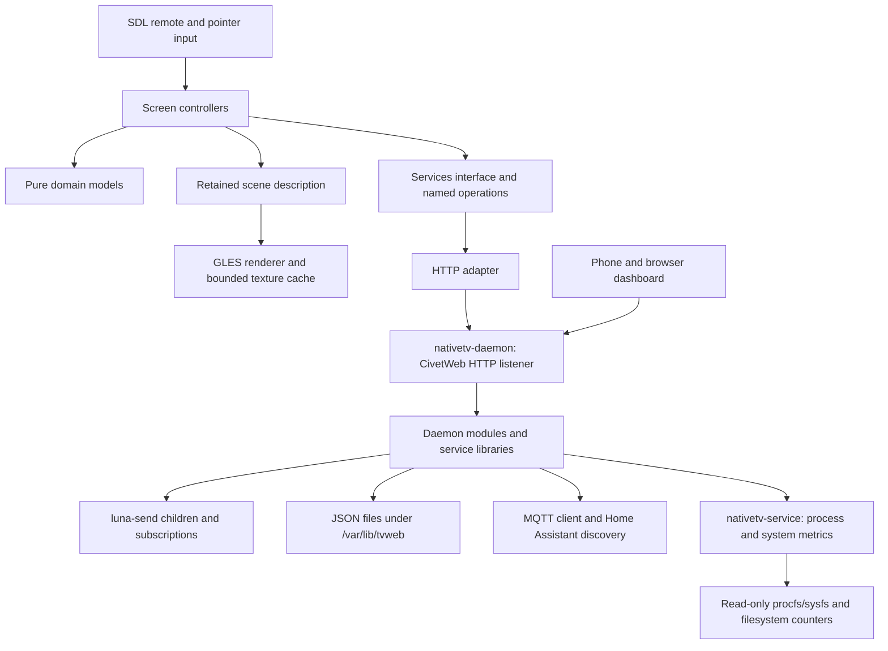

# Native application architecture

## Direction

`native-tv/` holds the TV application, the server that runs on the TV, the
phone/browser dashboard's source (under `web/`), the TV pages' assets (under
`assets/`), the lifecycle scripts (under `lifecycle/`) and all tests. The
server was a Node program until October 2026 and is one C++14 daemon, with a
metrics worker beside it, now; no Node runs on the TV. webOS 4 is the oldest
firmware the native server supports.

## Boundaries

- `core` owns operation identifiers, service replies and value ownership.
  It depends on neither rendering nor a particular backend.
- `domain` converts service data into typed cards, menu rows and commands.
  It also owns the shared raw-TV names (`names`) and English message helpers
  (`say`). It contains no I/O, threads, clock reads or GPU calls.
  `nativetv_state` adds the latest-value cache and pure reducers for Luna
  state replies.
- `ui` owns navigation, focus, editor state and request intent. A supplied
  clock and `Services` interface make asynchronous behavior testable. One
  `Motion` holds every animated value and advances by the frame time the
  application is given; views only read it. Home and Apps live in
  `home_motion.cpp` (what moves) and `home_view.cpp` (what is drawn, on the
  `kit` components). Other screens implement `ScreenView` (`screen.hpp`) in
  their own files and are registered in `screen_registry.cpp`; the application
  hosts them under the top bar and wall.
- `graphics` turns scene nodes into GL commands. It owns GL resources on
  the render thread. Fonts and decoded artwork become cached textures.
- `platform` owns process/window lifecycle and operating-system paths.
- `adapters` translates operations and opaque artwork references into the
  daemon's HTTP protocol. HTTP routes stay confined here.
- `service` owns the logic the daemon calls and that tests run without a TV:
  procfs/sysfs parsing and response assembly (`nativetv_metrics`: process and
  system snapshots, HDMI input mapping, the syslog parser and formatter), LG
  settings rows, OLED care, privacy and ad blocking, app lists, package
  inspection and install previews, background services, backup, watch history
  (`nativetv_history`), screen time, PicCap, Prometheus rendering and the
  Home content services. `nativetv_tv_services` holds device-service request
  rules separately from metrics collection, including Quick Access target
  validation and volume parsing.
- `daemon` owns persistence, scheduling and the HTTP front door.
  - The event loop keeps timers and callbacks on one thread and runs blocking
    work in a bounded pool. Each active Luna subscription holds a pool worker
    until it closes, so the pool is sized for the subscriptions plus regular
    blocking work (12 workers, raised to 12 when the state groups are on).
  - The config loader reads the file-only settings and keeps unknown JSON
    fields. `JsonFile` writes private temporary files, syncs file and directory
    metadata, retains a last-good copy and quarantines invalid state; deleting
    a record deletes its copy too. The logger applies the levels, flushes debug
    output and keeps a bounded ring of `/api/logs`-shaped entries.
  - The child runner starts processes with `posix_spawn`, captures bounded
    output and applies a serialized, urgent-aware launch gap. The Luna client
    uses it for bounded one-shot calls and supervised subscriptions with
    reconnect backoff.
  - `StateSubscriptions` owns the state groups, their refcounts, reconnect
    snapshot freshness and the audio and media service fallbacks.
    `StatsCollector` builds `/api/stats` from the system snapshot and the TV's
    services, with its own caches and invalidation.
  - `http_frontdoor` handles every route: authentication, CSRF preflight,
    first-run setup, the phone dashboard and static assets, and the controls,
    each behind a per-action command policy. `contract/routes.json` lists every
    route with its owner, and the checkers hold the front door to it.
  - MQTT: the client (libcurl connect-only TLS), the topic names, Home
    Assistant discovery, the telemetry payload, availability and the command
    router. Config changes republish discovery when the offered entities
    change.
  - Install jobs (download, inspection, preview, confirm, install, root
    elevation, cancel) with persistent job records; backup creation, daily
    backups and restore; the ad-block and custom hosts table with the SDP time
    grace; screen saver staging; the SAM rescan nudge and the app tile
    overrides.
  - `HomeTakeoverLifecycleManager` sequences LG Home's overlay, saved layout and
    SAM verification; `HomeRestoreManager` owns the standalone Home disable flow;
    `HomeOrchestrator` runs nativeTv Home's start, wake and LG auto-launch
    handling, and watches the native client that the Home stub (a web app
    mounted over LG's Home, with no screen) starts: `HomeProbeGate` runs the
    client's `--probe` before the takeover is offered or taken, and
    `HomeCrashBreaker` counts the client's failures, three in two minutes
    giving LG's Home its place back until the server restarts or Home is
    switched on again; `ServicesKeeper` re-applies the switched-off background services at
    start and every five minutes.
  - The remote keys (`remote_keys_reconciler`, `remote_button_log_watcher`,
    `remote_buttons`) follow LG's own writes to the key filters and the log.
  - `RetiredFiles` deletes at start the files earlier releases installed,
    including the Node release's `tvweb.js` and `lib/`.
  - `nativetv-daemon` composes these as a resident process with signal-driven
    shutdown; shutdown cancels Luna children before the event loop drains its
    workers. The pinned CivetWeb listener has bounded workers, header and body
    limits, dual-stack binding and IPv4 fallback; an explicit `0.0.0.0` host stays
    IPv4-only. The HTTP proxy code to a Node upstream is still compiled for the
    daemon's tests and answers 502 when there is no upstream.
- `main` constructs dependencies, dispatches input and replies and schedules
  rendering. It contains no TV control policy.

`TVWEB_DATA_DIR` relocates the data root; `nativetv-service` takes procfs and
system-root arguments, and the event loop accepts an injected clock, so tests
run the real modules against a fixture root.

## Service process

The native UI and the privileged TV service are separate processes. The render
loop does not own root-only service actions or block on network, filesystem,
package installation or Luna calls. The service interface is asynchronous
across the HTTP boundary and the daemon's in-process modules. Domain code does
not depend on a second transport.

`nativetv-service` is the disposable metrics worker. Its operations return
process reads and system snapshots through a versioned stdout envelope; its
watchdog operation also reaps a persistent direct child that is stuck before
exec, which the shell watchdog prefers. Snapshots include memory/swap, thermal
readings, eMMC health, clocks, app storage, CPU times, uptime/load,
network/Wi-Fi, picture-engine and Magic Remote pairing readings, plus the
`hasHdrStatus` and `hasHdmiProc` capability flags. Matching requests share one
child; failures back off per operation for one minute and execution has a
twelve-second limit. A missing or incompatible worker returns an API error. The
daemon keeps its own CPU window and network-rate baselines for API readers and
for Home Assistant's publish reads.

The runtime lives under `/var/lib/tvweb/native` and is independent of the client
IPK. Development and Homebrew installs replace binary inodes, so active reads
can finish during an update. The daemon calls Luna through bounded `luna-send`
subprocesses; direct LS2 remains optional follow-up work. A separate native IPC
adapter is skipped because the daemon HTTP API already serves the phone
dashboard and TV client.

`tools/runtime_payload.py` owns the runtime distribution manifest and ABI
checks. Its default mode stages the daemon, worker and recursively resolved SDK
shared libraries; `--client` stages the app and its non-system libraries beside
it. Both collect license notices and record SHA-256 hashes. SSH and Homebrew
packaging use the service payload, the app IPK and development deployment use
the client payload. The daemon and worker search the managed runtime directory;
the client uses `$ORIGIN` for colocated curl libraries. SDL2 and GLES remain TV
system libraries. TV executables embed json-c, so the runtime does not depend on
an SDK-specific json-c library. SSH and Homebrew builds require the runtime and
reject missing or non-ARM builds before deployment.

## Where things live

| Area | Home |
| --- | --- |
| TV UI and its tests | Domain, presentation and rendering targets; the TV pages under `assets/google-tv/`. |
| Device inventory and controls | `service/` and `daemon/` over Luna, with capability checks, confirmations, timeouts and failure reporting. |
| Profiles, layout and image caches | JSON files under `/var/lib/tvweb`, written atomically. |
| TMDB, YouTube and Wikidata | `service/home_*`, with the opt-in flags, bounded queues, disk caches, stale fallback and no-key behavior. |
| Installation, privacy and OLED | `daemon/install_jobs`, `service/privacy_*`, `service/oled_care`. |
| MQTT, Home Assistant and HTTP | `daemon/mqtt_*`, `daemon/ha_*`, `daemon/http_frontdoor`; entity IDs, authentication, CSRF defenses, phone setup and API compatibility are held by the contract checks and goldens. |
| Boot, watchdog and Home replacement | `lifecycle/tvwebctl`, `lifecycle/50-tvweb.sh` and the daemon's one-shot flags. |
| Tests | `tests/`: unit, `daemon_runtime.py`, `contract/`, `ui/`, `fixtures/`. |

Format changes to on-disk data need explicit versioning, atomic writes and
rollback support.

## Performance and verification

GPU work, API I/O and artwork I/O have separate ownership. Queues, replies,
textures and detail navigation are bounded. Stale responses cannot change a
newer screen. Backgrounding suspends polling and drawing; idle scenes submit
no frames. API correctness and navigation tests run without a graphics context.

Host checks cover deterministic models/controllers and sanitizer builds.
Integration checks exercise real HTTP responses and GL rendering. TV checks
cover library ABI, shader compilation/linking, actual drawable size, physical
remote behavior, foreground/background/relaunch and long-running memory use.
Frame submission timing is distinct from GPU execution and display latency.

## Decisions

- webOS 4 is the oldest firmware the native server supports.
- CivetWeb serves HTTP, and libcurl with the SDK's OpenSSL does MQTT TLS.
- The shell watchdog (`tvwebctl`) stays; the daemon writes the heartbeat it
  watches.
- There is no native IPC adapter; the daemon's HTTP API serves its consumers.
- The phone dashboard's source stays in `native-tv/web/`.
